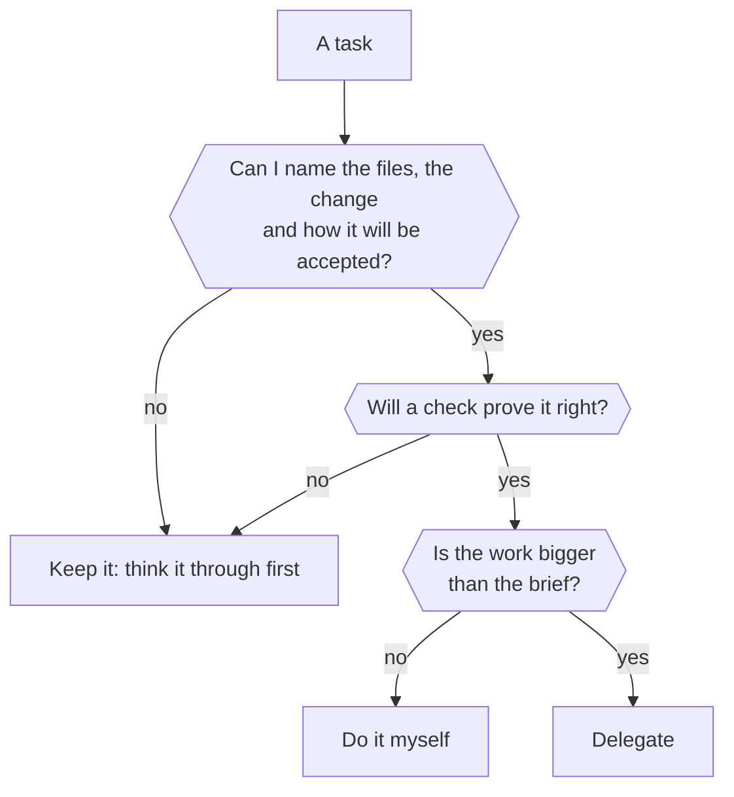

# Delegating work to a cheaper model

The aim is to make the usage cap go further. The main session does the work where judgement is the hard part, and hands the rest to a subagent on a cheaper model (Sonnet for now). Quality must not drop.

## What to delegate

Delegating has a fixed cost: writing the brief, then reviewing the result. It pays off when the work itself costs more than that.

- **Good candidates:** refactors the specs prove, new specs, benches, documentation tables, renames, mechanical moves between files.
- **Keep in the main session:** design and API choices, diagnosis (races, hangs, regressions, results that don't add up), performance work, reviews, and anything the user has decided or should decide.

## The standing brief

One agent definition, `.claude/agents/implementer.md`, with `model: sonnet` and only the tools the work needs. It holds what every task needs, so each task's brief carries only the task:

- what to read first: the project's conventions, and the files the brief names;
- the rules that matter, and the exact commands for the checks;
- what not to do: commit, push, or edit files outside the brief without saying why;
- **if the brief is unclear or seems wrong, stop and report the question.** It cannot ask mid-task, but the main session can answer and resume the same agent;
- how to report: a line per changed file, the last line of each check verbatim, and anything assumed or left undone;
- lessons from earlier tasks, added after each review.

## Each task's brief

Written for a capable colleague who has seen none of the conversation: the goal and why, the files to change and to read, the change itself precisely enough to need no design decisions, the checks that must pass, and what is out of scope.

Run the subagent in an isolated worktree so its edits cannot collide with the main session's. Gitignored tools and build outputs are not in a new worktree, so the brief must say where to find them.

## After it reports

Read the whole diff and rerun the checks; the report is a claim, not a proof. Fix or reject what is wrong, and add the lesson to the standing brief. The main session commits, and the commit message (and the PR, if there is one) says what was delegated. Remove the worktree when done.

## Keeping context

Delegation also keeps long file reads and check output out of the main session; only the report comes back. A handoff document (`HANDOFF.md`) holds how we work, where things stand and what's next. Rewrite it rather than append: at the end of each piece of work, and after the conversation has been summarised. Anything that belongs in the project's own documents goes there instead.

## Is it paying off?

After the first delegated task, and now and then after that, compare what the delegation saved with what the brief and review cost. Tell the user, with numbers: the subagent's tokens and time (its result reports both), and how many corrections were needed. Stay on one cheaper model until it has shown it helps; only then try a cheaper one still for the simplest tasks.
