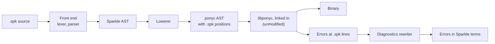
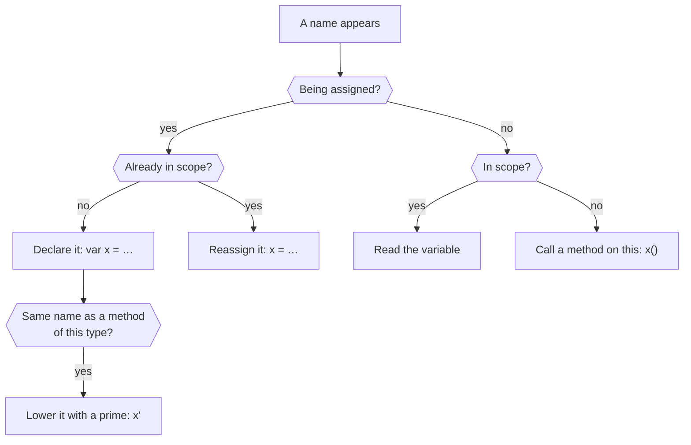
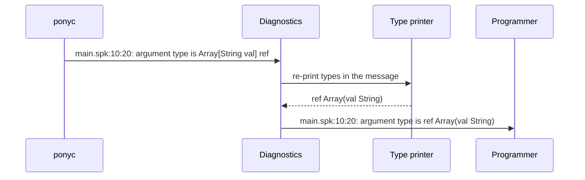
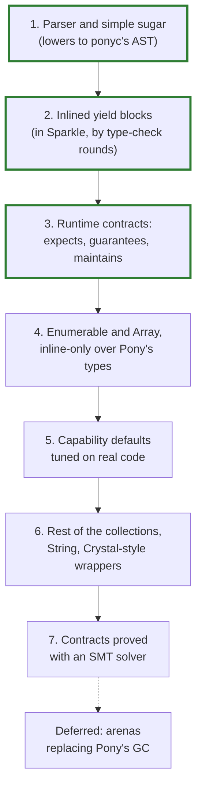
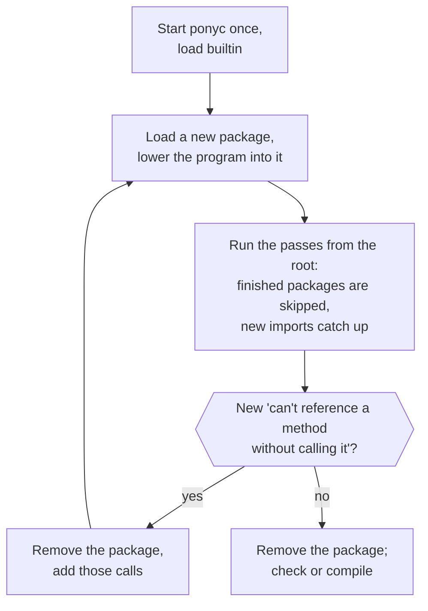
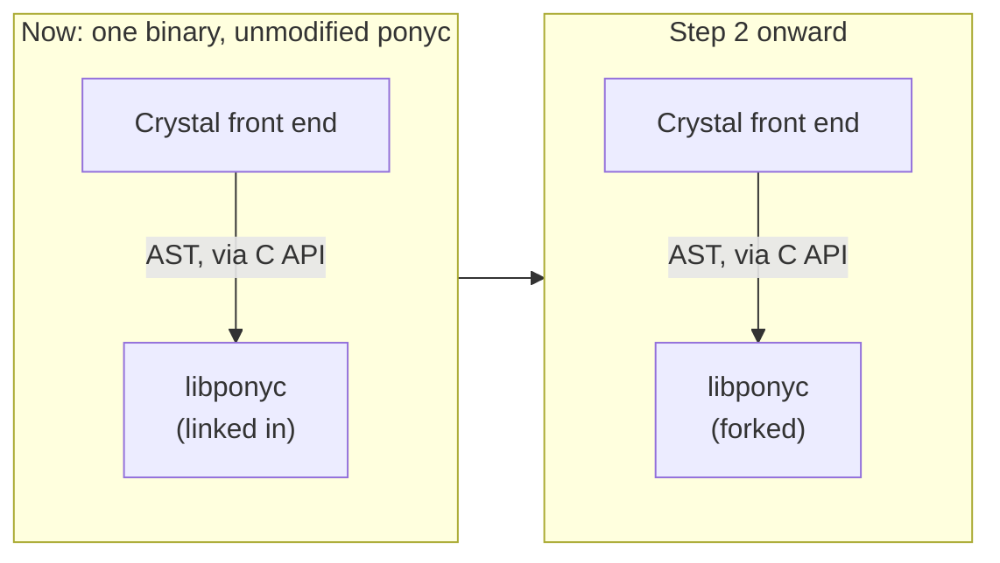

# Sparkle design

This document says how Sparkle is put together and why. Read [README.md](README.md) first for what it does from the outside.

## The shape of it

Sparkle is at step 1 of its roadmap: a front end for an unmodified Pony compiler. Think of it as an interpreter standing between a Crystal speaker and a Pony compiler. It translates what is said in one direction (source) and what comes back in the other (errors). It has **no type information** of its own, so the one rule that needs types, whether `x.name` is a field or a method, is settled by asking the compiler.

Every translation rule is in [docs/step1-spec.md](docs/step1-spec.md). This document covers the structure and the reasoning.

## Layers

Each layer is one file in `src/sparkle/`, or a directory for the compiler, and depends only on the layers above it in this table.

| Layer | File | Outcome |
|---|---|---|
| Tokens | `token.cr`, `lexer.cr` | Source text becomes tokens, each with a line and column |
| Syntax tree | `ast.cr`, `parser.cr` | Tokens become an AST; every node keeps its position |
| Type printing | `pony_type.cr` | A type is printed in Pony syntax, or parsed from Pony syntax and printed in Sparkle's |
| Rules | `rules.cr` | The naming and declaration rules: Pony names, primed parameters, enum predicates, implicit constructors |
| Diagnostics | `diagnostics.cr` | `ponyc`'s messages are re-printed with Sparkle's types and names |
| Statistics | `cap_stats.cr` | Capability annotations are counted per file |
| Compiler | `ponyc/lib_ponyc.cr`, `ponyc/shim.c`, `ponyc/compiler.cr`, `ponyc/session.cr`, `ponyc/tree.cr`, `ponyc/token_ids.cr` | An AST built node by node is type-checked or compiled in-process by the linked-in `libponyc`, and its errors come back as data and as text |
| Contracts | `contracts.cr` | `expects`, `guarantees` and `maintains` become plain methods: a wrapper that checks around the renamed body |
| Packages | `packages.cr`, `ponyc/packages.cr` | The packages a build requires are found, parsed and ordered, and each is added to the program as an in-memory Pony package |
| Inlining | `inliner.cr` | Each call with a block to a yielding method is replaced by a copy of its body |
| Lowering | `lowerer.cr` | The AST becomes ponyc AST nodes with Sparkle positions |
| Driver | `driver.cr`, `src/sparkle.cr` | A Pony installation is found, fields are told from methods, the package is compiled, and the CLI is exposed |

### Front end

The lexer and parser are hand-written; the parser is recursive descent with precedence climbing for operators. Two points are specific to Sparkle:

- **Capability words are contextual.** `iso`, `val`, `ref` and the rest lex as plain identifiers. The parser treats them as capabilities only in type position, after `def`, after a type-declaration keyword, and after `recover`. So `val` and `ref` remain usable as variable names.
- **Each capability the programmer writes is recorded**, with its position (`def`, type, declaration, `recover`). The statistics layer reads that record.

### Lowerer

The lowerer builds the tree `ponyc`'s parser would build from the equivalent Pony, node for node, and sets each node's position to the Sparkle line and column it came from. Pony's own sugar pass then runs on it, as on parsed code. The spec writes each rule as Sparkle beside that equivalent Pony, and the rule specs check the lowered tree against `ponyc`'s parse of it.

It carries the one piece of knowledge a typeless translator can have: **lexical scope**. From that it decides three things.

Pony has no operator precedence, so the lowerer groups every nested binary expression according to Crystal's, as parentheses would in Pony text.

### Diagnostics

The nodes carry `.spk` positions, so `ponyc` already reports at the Sparkle line and quotes it. What is left is the message: types are re-printed in Sparkle's syntax, primed names lose their prime, and enum members get their Sparkle names back.

The rewriter is a pure function of `ponyc`'s output and the enum names, so it can be tested without running `ponyc`.

### Driver

`sparkle build` treats a directory of `.spk` files as one Pony package. It lowers every file into one in-memory package, settles fields and methods by type-checking (see below), and compiles the result in-process. `sparkle translate` prints the same tree, as `ponyc --astmodule` would. The code is unoptimised unless `--release` is given, as with `crystal build`: LLVM's optimiser is most of a build's time, so a debug build of hello world takes about 1.4 s and an optimised one about 3 s. The standard library comes from the Pony installation holding the first `ponyc` found in `$SPARKLE_PONYC`, then `.tools/ponyc`, then the vendored build, then `PATH`; it should be the release whose `libponyc` was linked in, which `make ponyc` installs.

The compiler is linked from `.tools/ponyc/lib/<arch>/libponyc-standalone.a`, with LLVM, lld and clang inside, so `bin/sparkle` is about 160 MB. The archive's `libponyc` and runtime objects are LLVM bitcode, so on Linux it is linked with `lld`, and on macOS it needs an Xcode whose `libLTO` is at least as new as the clang that built the release. A C shim compiled from `vendor/ponyc`'s headers sets the options that live in `pass_opt_t` and collects the errors as text. Each compile, and each run of the field-or-method loop, runs `ponyc_init` and `ponyc_shutdown` once: one initialisation cannot be shared between option sets, and repeating the pair in one process works. `ponyc_init` installs LLVM's crash handlers, which on Linux include `SIGXCPU`, one of the two signals Crystal's garbage collector uses to pause and resume threads; the shim saves the collector's two handlers before `ponyc_init` and restores them after, so LLVM never sees them.

## Decisions

### An operating system is assumed

Sparkle targets systems with an operating system: servers, desktops and embedded Linux today, and possibly a real-time OS later. Bare metal, with no OS at all, is not a goal. Pony's runtime needs threads and memory mapping, and Sparkle keeps that.

### Crystal's idiom, unless it breaks capabilities or contracts

Sparkle reads like Crystal or Ruby wherever it can. Where Crystal's idiom would weaken reference capabilities, or make contracts unsound or unprovable, Sparkle designs a form of its own rather than copy Crystal. I/O is the expected case: Crystal reaches files through ambient authority (`File.read("x")`), and Pony requires an authority token from `env.root`.

### Wrap Pony's standard library

Sparkle keeps Pony's standard library and puts Crystal-style layers over it, rather than keeping Pony's style or rewriting it. A method that `yield`s is never compiled, only copied into its callers, so Enumerable can be a set of inline-only methods on Pony's own collections, and other wrappers thin Sparkle types over Pony's packages. Keeping Pony's garbage collector removes the risk this carried: the library runs on the runtime it was written for.

### Build on Pony, not Crystal

Pony already has reference capabilities, actors, local type inference and an LLVM back end. Starting from Crystal would mean tearing out its global type inference and its garbage collector, then adding everything Pony has.

### Leave Pony unmodified first

Step 1 changes nothing in Pony: it builds the AST Pony's parser would build, and Pony does the rest. That keeps the first step cheap and lets the syntax be tried on real programs before any compiler work. The cost is the lack of type information, which forces the compromises below.

### The translator is written in Crystal

It is the syntax being imitated, and Crystal calls C libraries without glue code. The second point matters for the next step: see [One binary](#one-binary).

### Fields are private

`@n` becomes Pony's private field `_n`. This is Crystal's rule, and it lets a field and a method share a name (`@count` beside `def count`), which Pony forbids.

### A bare dot-name is a field unless the compiler says otherwise

Without types the translator cannot tell `x.size` the method from `x.size` the field. Step 1 made every dot-name a call and spelled a field read `x.@name`, at the price of `env.@out`. Now that `libponyc` is linked in, `sparkle build` lowers a bare `x.name` as a field read, type-checks, and turns each one the checker reports as "can't reference a method without calling it" into a call, repeating until nothing new is reported. The default is a field because calling a field means calling `apply()` on its value, which fails with an unrelated error or compiles with another meaning. A table of known field names was rejected earlier because the Pony standard library has hundreds of public fields; the type checker already knows them all. The rule is in [docs/step1-spec.md](docs/step1-spec.md#fields-and-methods).

### `!` means "can fail", `?` means "predicate"

`first!` becomes Pony's partial call `first()?`, so `ponyc` verifies the marker at both definition and call. `empty?` becomes `is_empty`.

### Crystal's defaults where Pony has none

| Sparkle | Pony's behaviour | Sparkle's rule |
|---|---|---|
| `x = 0`, `[1, 2]`, `7.string`, `"#{1 + 2}"` | Cannot infer a literal's type without context | `Int32`, or `Float64` with a float literal, wherever nothing else gives one |
| A parameter named like a method | Forbidden | Given a prime (`payload'`) |
| A class whose fields all have defaults | Infers an `iso` constructor | Gets an explicit constructor, giving `ref` |

Pony's behaviours are Sparkle's **message handlers**, declared with `on` and reached with `<~`, not with `be` and a plain call. A caller calls a method and waits for its reply, or posts a message and goes on, trusting the handler to process it and expecting nothing back. `be` read as "be a method", and "behaviour" says nothing about a message, so both words stay in Pony; the handler runs later, when its message reaches the actor, and returns nothing. `on add(n)` names when it runs. At the call, `counter <~ add(3)` shows the hand-off, which a plain `counter.add(3)` hides; the marker is required both ways, so its presence and its absence can both be trusted. It also explains why output from two actors interleaves: `env.out <~ print(s)` is a message too. `<~` points into the receiver, as Go's `<-` does, and the wave says "not now"; it costs Crystal's `a <~b` (`a < ~b`), which needs a space. `->` stays free for lambdas. The aim is that Sparkle does not expose Pony's spelling where Crystal or Ruby would expect another.

The integer default is `Int32`, matching Crystal and Rust. `Int64` was weighed and set aside for now: it costs almost nothing on 64-bit hardware and moves the overflow point from about 2.1 billion to out of reach, which matters because Pony's `+` wraps silently. The trade is compatibility over overflow headroom, and it may be revisited. Contracts (roadmap step 7) are the planned answer to overflow: prove a value stays in range rather than widen its type.

### An assignment's value is the new value

Crystal's rule, not Pony's. Where the value is used, `y = 5` becomes `(y = 5; y)`; as a statement it is left alone. The cost is Pony's swap idiom, `a = b = a`, which relies on assignment returning the old value. Index, setter and field assignments are not read back, because re-reading `a(i)` is a partial call and `x.name` would evaluate `x` twice, so using their value is an error.

### Blocks and `yield`

A call with a block to a Sparkle method that `yield`s is inlined: the block runs in the caller, with no closure, so it can assign the caller's locals. The method is found by the receiver's type, read from a type-checking round, and the copy is made in Sparkle's AST before lowering, so no ponyc fork is needed ([docs/spike-yield.md](docs/spike-yield.md)). Otherwise `each`, `each_with_index` and `times` with a block become real Pony `for` loops, chosen by method name, so `break` and `next` work. Any other block becomes a lambda passed as the last argument.

### An enum is a set of primitives

Pony has no `enum`. Each member becomes a `primitive`, prefixed with the enum's name so that two enums can both have a `Red`, and the enum becomes a union of them, which makes `case … in` exhaustive. Each member carries `value`, `string`, `eq`, `ne` and a predicate per member of its enum (`red?` is `is_red`), and `when .red?` in a `case` is the member's type pattern when exactly one enum in the package has that member. Because Pony does not count a primitive with its own `eq` towards an exhaustive match, a member in a `case` pattern is matched by type (`let _: ColourRed`), not by value.

### Dropped on purpose

Range types (`Int(1..10)`). An exhaustive `case … in` over an enum covers the need.

## Roadmap

Steps 1 to 3 are built; step 2 lacks `return` with a value in a yielding method, and `next` or `break` where the call's value is used, and step 3 does not yet take clauses on yielding, abstract or `tag` methods. Contracts come before the library because the user wants them sooner, and because how a contract fails and what it may call shape the rest ([docs/contracts-design.md](docs/contracts-design.md)). Arenas are deferred, perhaps for good: Pony's garbage collector stays, and with it the unmodified upstream `ponyc`. A fork, a small set of named patches rebased onto each release, is needed only if a rule must change the type checker mid-pass; type-check rounds have covered every rule so far ([docs/spike-yield.md](docs/spike-yield.md)).

### One binary

The Crystal front end links `libponyc` and builds its AST directly, rather than writing Pony text for a second process to read. It was built in four stages, each proved against the text emitter it replaced:

| Stage | Outcome | State |
|---|---|---|
| 1. Foundation | `Ponyc::Tree` builds nodes, `Ponyc.compile_tree` compiles them, and `Ponyc::Tk` holds token ids generated at compile time from `token.h`, so a Pony upgrade cannot leave them stale | Done |
| 2. Lowering | `Lowerer` turns Sparkle's AST into ponyc's, for every example | Done |
| 3. Parity | Every example and fixture gives the same tree, output and errors on both paths | Done |
| 4. Switch | The AST path is the only one. Every rule the emitter's specs covered lowers to the tree `ponyc` parses from the same Pony; the emitter, the source map and the location half of the diagnostics rewriter are gone | Done |

The field-or-method loop keeps one compiler for all its rounds (`Ponyc::Session`). Loading a package and taking it through the passes is the expensive part, about 2 s for `collections`, and ponyc records on each node the last pass it has been through. So the session loads `builtin` once, and each round lowers the program into a fresh package beside it, runs the passes, which skip every package already through them, and removes the package again. Only the first round pays for the standard library; later rounds take under 0.1 s, so `examples/ring` settles in 2.8 s instead of 7 s. `sparkle check` runs its final full check in the same session.

Two details make it work. A package loaded late is brought straight up to the program's last pass, so the session loads it at the parse pass and adds the lowered nodes before any pass runs. And the program's root records its own last pass, so the session clears that record, and only that one, before each round. Compiling still starts a fresh `ponyc`, because the program it generates must have the user's package at its root.

The AST's shape is internal to ponyc. `ponyc --pass=parse --astmodule` prints what the parser builds, and the lowering must match it, so it is re-checked on every Pony upgrade: the rule specs and each example's `expected.ast` catch a change.

Syntax stays in Crystal. A rule that needs types is written in Crystal first, by type-checking, reading the result and lowering again, as field-versus-call resolution is. Only what must change the type checker mid-pass would move into a fork as C patches; a spike showed `yield` inlining is not such a rule ([docs/spike-yield.md](docs/spike-yield.md)), and none is known yet.

A spike has shown it works, on Linux with the unmodified 0.78.2 release: Crystal links `libponyc-standalone.a`, builds an AST, compiles it to a running binary, and gets errors reported at `.spk` lines from positions set on the nodes. A small C shim sets compiler options and exports enum values. A second stage told fields from methods by type-checking, reading `ponyc`'s errors and rebuilding, with no fork. See [docs/spike-libponyc.md](docs/spike-libponyc.md) for the details, costs and what is still untested.

### Later design notes

- **Memory.** Each actor gets a long-lived heap for its state and a scratch arena per behaviour, wiped when the behaviour returns. A value that escapes into a field is promoted to the actor's heap. Sending an `iso` hands over ownership; shared `val` objects are reference-counted.
- **Inlined `yield`.** A block's code runs inside the caller with no closure object, so nothing is allocated. Lambdas remain for blocks that outlive the call.
- **Errors.** A function that can fail returns a typed error; `raise` and `rescue` are sugar for that.
- **Fan-out and gather.** A message handler that returns a value gives back a future; `await_all` parks the calling actor until the results arrive.
- **Contracts.** Checked at runtime first, then proved with an SMT solver where possible. `iso` and `val` rule out aliasing, which is what usually makes proofs about imperative code hard.

## Open questions

- **Reopening Sparkle types.** Pony's types can be reopened with inline-only methods (docs/enumerable-design.md); whether a Sparkle type may be reopened too is open. Forbidding it keeps a type's methods in one place, which makes contracts easier to prove.
- **Macros.** Now, later or never? A few built-in declarations (`getter`, `property`, `record`) might cover most uses.
- **Is Pony's garbage collector actually a problem?** It collects per actor, between behaviours, with no stop-the-world pause. The real reason to remove it may be runtime size, not latency. Arenas are deferred until this is answered.
## Not built

- `return` with a value in a yielding method, and `next` or `break` in a block whose call's value is used
- Contract clauses on yielding, abstract or `tag` methods, and `maintains` in traits, interfaces and primitives
- Methods inside an `enum`, flag enums, and enums with a base type
- Macros: `getter`, `property`, `record`
- Calls with arguments but no parentheses (`puts "x"`)
- Hash and symbol literals
- FFI
- `let` and `embed` fields
- Generic method calls
- Reopening types
- Qualified names across packages (`Geometry::Point`), and two packages defining the same type name
- Ranges and `times` over anything but `USize`
- Contracts, Sparkle packages beyond one, and everything from step 3 onward
