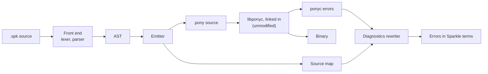
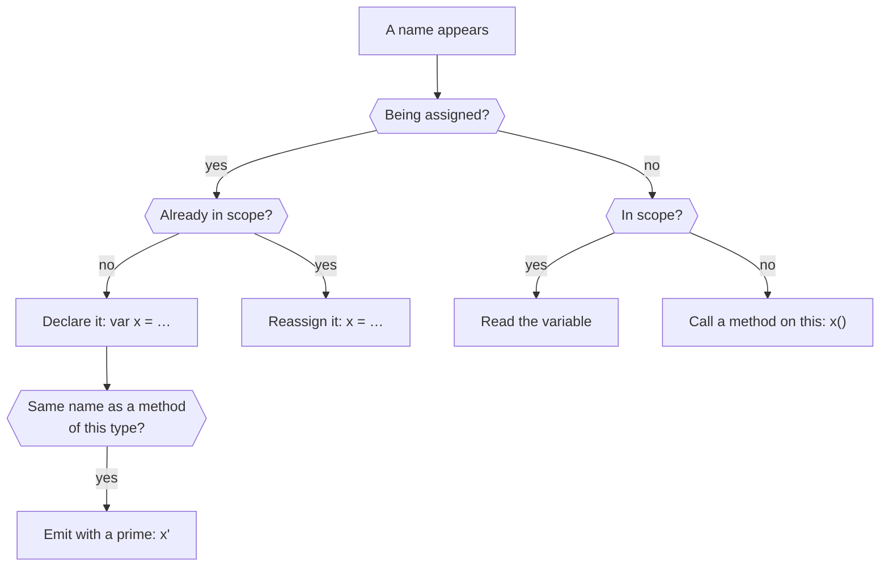
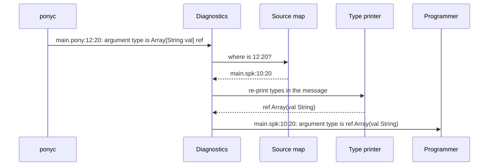
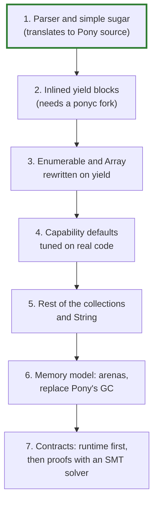
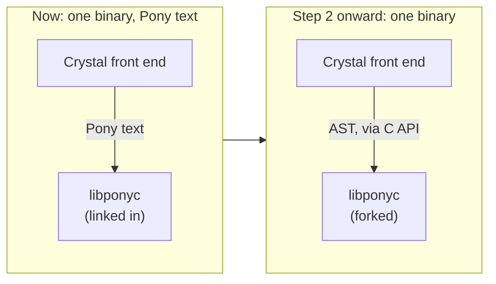

# Sparkle design

This document says how Sparkle is put together and why. Read [README.md](README.md) first for what it does from the outside.

## The shape of it

Sparkle is at step 1 of its roadmap: a source-to-source translator. Think of it as an interpreter standing between a Crystal speaker and a Pony compiler. It translates what is said in one direction (source) and what comes back in the other (errors), and it does so without understanding the subject: it has **no type information**.

Every translation rule is in [docs/step1-spec.md](docs/step1-spec.md). This document covers the structure and the reasoning.

## Layers

Each layer is one file in `src/sparkle/`, or a directory for the compiler, and depends only on the layers above it in this table.

| Layer | File | Outcome |
|---|---|---|
| Tokens | `token.cr`, `lexer.cr` | Source text becomes tokens, each with a line and column |
| Syntax tree | `ast.cr`, `parser.cr` | Tokens become an AST; every node keeps its position |
| Type printing | `pony_type.cr` | A type is printed in Pony syntax, or parsed from Pony syntax and printed in Sparkle's |
| Emitter | `emitter.cr`, `source_map.cr` | The AST becomes Pony source, plus a map from each Pony position back to Sparkle |
| Diagnostics | `diagnostics.cr` | `ponyc`'s output is rewritten into Sparkle locations and types |
| Statistics | `cap_stats.cr` | Capability annotations are counted per file |
| Compiler | `ponyc/lib_ponyc.cr`, `ponyc/shim.c`, `ponyc/compiler.cr`, `ponyc/tree.cr`, `ponyc/token_ids.cr` | A Pony package, as text or as an AST built node by node, is compiled in-process by the linked-in `libponyc`, and its errors come back as text |
| Lowering | `lowerer.cr` | The AST becomes ponyc AST nodes with Sparkle positions; opt-in and partial, see [One binary](#one-binary) |
| Driver | `driver.cr`, `src/sparkle.cr` | Files are generated, a Pony installation is found, the package is compiled, and the CLI is exposed |

### Front end

The lexer and parser are hand-written; the parser is recursive descent with precedence climbing for operators. Two points are specific to Sparkle:

- **Capability words are contextual.** `iso`, `val`, `ref` and the rest lex as plain identifiers. The parser treats them as capabilities only in type position, after `def`, after a type-declaration keyword, and after `recover`. So `val` and `ref` remain usable as variable names.
- **Each capability the programmer writes is recorded**, with its position (`def`, type, declaration, `recover`). The statistics layer reads that record.

### Emitter

The emitter writes Pony as a stream, not by building strings bottom-up. That lets a multi-line construct, such as a lambda or an `if` used as a value, sit inside an expression.

It carries the one piece of knowledge a typeless translator can have: **lexical scope**. From that it decides three things.

Pony has no operator precedence, so the emitter parenthesises every nested binary expression according to Crystal's.

### Source map and diagnostics

As it writes, the emitter drops a mark each time it starts a node: Pony line and column, paired with the Sparkle line and column. A `ponyc` location is resolved to the last mark at or before it.

The rewriter is a pure function of `ponyc`'s output, the source maps and the sources. It can therefore be tested without running `ponyc`.

### Driver

`sparkle build` treats a directory of `.spk` files as one Pony package. It writes one `.pony` file per source file under `.sparkle/<package>/` and compiles that directory in-process. The standard library comes from the Pony installation holding the first `ponyc` found in `$SPARKLE_PONYC`, then `.tools/ponyc`, then the vendored build, then `PATH`; it should be the release whose `libponyc` was linked in, which `make ponyc` installs.

The compiler is linked from `.tools/ponyc/lib/<arch>/libponyc-standalone.a`, with LLVM, lld and clang inside, so `bin/sparkle` is about 160 MB. The archive's `libponyc` and runtime objects are LLVM bitcode, so on Linux it is linked with `lld`, and on macOS it needs an Xcode whose `libLTO` is at least as new as the clang that built the release. A C shim compiled from `vendor/ponyc`'s headers sets the options that live in `pass_opt_t` and collects the errors as text. Each compile or type check runs `ponyc_init` and `ponyc_shutdown` once: one initialisation cannot be shared between option sets, and repeating the pair in one process works. `ponyc_init` installs LLVM's crash handlers, which on Linux include `SIGXCPU`, one of the two signals Crystal's garbage collector uses to pause and resume threads; the shim saves the collector's two handlers before `ponyc_init` and restores them after, so LLVM never sees them.

## Decisions

### Build on Pony, not Crystal

Pony already has reference capabilities, actors, local type inference and an LLVM back end. Starting from Crystal would mean tearing out its global type inference and its garbage collector, then adding everything Pony has.

### Translate to source first

Step 1 changes nothing in Pony. That keeps the first step cheap and lets the syntax be tried on real programs before any compiler work. The cost is the lack of type information, which forces the compromises below.

### The translator is written in Crystal

It is the syntax being imitated, and Crystal calls C libraries without glue code. The second point matters for the next step: see [One binary](#one-binary).

### Fields are private

`@n` becomes Pony's private field `_n`. This is Crystal's rule, and it lets a field and a method share a name (`@count` beside `def count`), which Pony forbids.

### A bare dot-name is a field unless the compiler says otherwise

Without types the translator cannot tell `x.size` the method from `x.size` the field. Step 1 made every dot-name a call and spelled a field read `x.@name`, at the price of `env.@out`. Now that `libponyc` is linked in, `sparkle build` emits a bare `x.name` as a field read, type-checks, and turns each one the checker reports as "can't reference a method without calling it" into a call, repeating until nothing new is reported. The default is a field because calling a field means calling `apply()` on its value, which fails with an unrelated error or compiles with another meaning. A table of known field names was rejected earlier because the Pony standard library has hundreds of public fields; the type checker already knows them all. The rule is in [docs/step1-spec.md](docs/step1-spec.md#fields-and-methods).

### `!` means "can fail", `?` means "predicate"

`first!` becomes Pony's partial call `first()?`, so `ponyc` verifies the marker at both definition and call. `empty?` becomes `is_empty`.

### Crystal's defaults where Pony has none

| Sparkle | Pony's behaviour | Sparkle's rule |
|---|---|---|
| `x = 0` | Cannot infer a bare literal's type | `Int32`, or `Float64` for a float literal |
| A parameter named like a method | Forbidden | Emitted with a prime (`payload'`) |
| A class whose fields all have defaults | Infers an `iso` constructor | Emits an explicit constructor, giving `ref` |

### An assignment's value is the new value

Crystal's rule, not Pony's. Where the value is used, `y = 5` becomes `(y = 5; y)`; as a statement it is left alone. The cost is Pony's swap idiom, `a = b = a`, which relies on assignment returning the old value. Index, setter and field assignments are not read back, because re-reading `a(i)` is a partial call and `x.name` would evaluate `x` twice, so using their value is an error.

### Blocks without `yield`

Step 1 has no `yield`. `each`, `each_with_index` and `times` with a block become real Pony `for` loops, chosen by method name, so `break` and `next` work. Any other block becomes a lambda passed as the last argument.

### An enum is a set of primitives

Pony has no `enum`. Each member becomes a `primitive`, prefixed with the enum's name so that two enums can both have a `Red`, and the enum becomes a union of them, which makes `case … in` exhaustive. Each member carries `value`, `string`, `eq` and `ne`. Because Pony does not count a primitive with its own `eq` towards an exhaustive match, a member in a `case` pattern is matched by type (`let _: ColourRed`), not by value.

### Dropped on purpose

Range types (`Int(1..10)`). An exhaustive `case … in` over an enum covers the need.

## Roadmap

Step 1 is built. Where `ponyc` comes from changes as the steps advance:

| Phase | Source of `ponyc` |
|---|---|
| Step 1 | Submodule pinned to an upstream release tag, unmodified |
| Steps 2–5 | Submodule pointing at a fork: a small set of named patches, rebased onto each release |
| Step 6 onward | The runtime diverges; stop tracking upstream or switch to `git subtree` |

### One binary

From step 2 the plan is for the Crystal front end to link `libponyc` and build its AST directly, instead of writing Pony text and starting a second process. The first half is done: `libponyc` is linked in and compiles the generated Pony text in-process. The second half, building the AST, goes in stages, with the text emitter as the default until the last:

| Stage | Outcome | State |
|---|---|---|
| 1. Foundation | `Ponyc::Tree` builds nodes, `Ponyc.compile_tree` compiles them, and `Ponyc::Tk` holds token ids generated at compile time from `token.h`, so a Pony upgrade cannot leave them stale | Done |
| 2. Lowering | `Lowerer` turns Sparkle's AST into ponyc's, behind `SPARKLE_AST=1`. An example counts as lowered when its tree prints identically to the one ponyc parses from its `expected.pony`, and its binary gives `expected.out` | Done: `fields`, `counter`, `fizzbuzz`, `handoff`, `shapes`, `ring`, `traffic` |
| 3. Parity | Every example and fixture passes through the AST path as well as the text path | |
| 4. Switch | The AST path becomes the default; the field-or-method loop rewrites nodes; the emitter, the source map and the location half of the diagnostics rewriter are retired | |

The AST's shape is internal to ponyc. `ponyc --pass=parse --astmodule` prints what the parser builds, and the lowering must match it, so it is re-checked on every Pony upgrade.

Syntax stays in Crystal. Anything that needs types moves into the fork as C patches, because that is where the types are: `yield` inlining, field-versus-call resolution, capability defaults. The step 1 emitter, source map and diagnostics rewriter are retired at that point; AST nodes carry their own positions, so `ponyc` reports against `.spk` files directly.

A spike has shown it works, on Linux with the unmodified 0.78.2 release: Crystal links `libponyc-standalone.a`, builds an AST, compiles it to a running binary, and gets errors reported at `.spk` lines from positions set on the nodes. A small C shim sets compiler options and exports enum values. A second stage told fields from methods by type-checking, reading `ponyc`'s errors and rebuilding, with no fork. See [docs/spike-libponyc.md](docs/spike-libponyc.md) for the details, costs and what is still untested.

### Later design notes

- **Memory.** Each actor gets a long-lived heap for its state and a scratch arena per behaviour, wiped when the behaviour returns. A value that escapes into a field is promoted to the actor's heap. Sending an `iso` hands over ownership; shared `val` objects are reference-counted.
- **Inlined `yield`.** A block's code runs inside the caller with no closure object, so nothing is allocated. Lambdas remain for blocks that outlive the call.
- **Errors.** A function that can fail returns a typed error; `raise` and `rescue` are sugar for that.
- **Fan-out and gather.** A behaviour that returns a value gives back a future; `await_all` parks the calling actor until the results arrive.
- **Contracts.** Checked at runtime first, then proved with an SMT solver where possible. `iso` and `val` rule out aliasing, which is what usually makes proofs about imperative code hard.

## Open questions

- **Reopening types.** Allow adding methods to an existing type elsewhere, or not? Forbidding it keeps a type's methods in one place, which makes contracts easier to prove.
- **Macros.** Now, later or never? A few built-in declarations (`getter`, `property`, `record`) might cover most uses.
- **Is Pony's garbage collector actually a problem?** It collects per actor, between behaviours, with no stop-the-world pause. The real reason to remove it may be runtime size, not latency.
- **What happens to Pony's standard library?** Today Sparkle uses all of it. Steps 3 and 5 rewrite `Enumerable`, the collections and `String` in Sparkle's style; nothing says what happens to the rest (files, networking, time, processes) once step 6 forks the runtime. Three end states:

  | Option | Gain | Cost |
  |---|---|---|
  | Sparkle's own core, Pony's library for the rest, for good | Cheapest; inherits a large, tested library written to the same capability rules | The language reads two ways: Crystal style for collections, Pony style for I/O. After the fork, every kept package is code Sparkle maintains alone |
  | Rewrite everything in Sparkle, in time | One consistent library | The most work, and none of Pony's maturity |
  | Wrap rather than rewrite: thin Sparkle-style layers over Pony's packages, such as a Crystal-like `File` over `files` | Consistent on the surface, cheap underneath | Depends on Pony's library surviving step 6's arenas, for example objects that outlive the behaviour that made them |

  Two questions decide it: how far a Sparkle program should read like Crystal rather than Pony with Crystal's syntax, and whether Sparkle keeps pulling from upstream Pony after step 6. It should be settled before step 3 commits to a direction.

## Not built

- `yield`
- Methods inside an `enum`, flag enums, and enums with a base type
- Macros: `getter`, `property`, `record`
- Calls with arguments but no parentheses (`puts "x"`)
- Hash and symbol literals
- FFI
- `let` and `embed` fields
- Generic method calls
- Reopening types
- Ranges and `times` over anything but `USize`
- Contracts, arenas, futures: everything from step 2 onward
