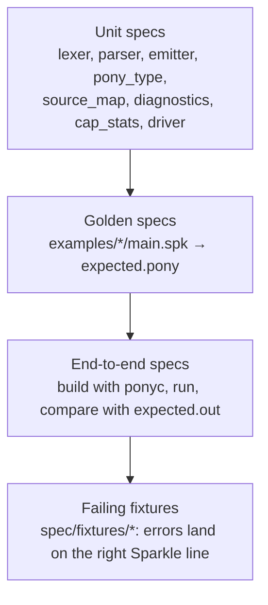

# Developing Sparkle

How to build, test and change this shard. For how it works, see [DESIGN.md](DESIGN.md).

## Dependencies

1. Make sure you have the Crystal toolchain installed, version 1.19 or later (`ameba` 1.7 needs it).
   - via `brew install crystal` for macOS and Linux (if you are so inclined)
   - or directly [install Crystal](https://crystal-lang.org/install/) from the website
2. `make` and `curl`.
3. The Pony compiler, `ponyc`. `make ponyc` fetches it; see below.
4. Only to build `ponyc` from source: Clang, CMake 3.25 or later, Python 3, and the zlib and OpenSSL development headers.

Sparkle has no runtime shard dependencies. Its one development dependency is the linter, `ameba`.

## Build

### Dependency check

Run the following to update dependencies and build `ameba` the first time, or when dependencies change.

```sh
shards check || (shards install && mkdir -p bin && cp lib/ameba/bin/ameba.cr bin && crystal build -o bin/ameba bin/ameba.cr)
```

### First time

```sh
git submodule update --init
```

```sh
make ponyc
```

```sh
make build
```

`make ponyc` downloads the prebuilt Pony release matching `vendor/ponyc/VERSION` into `.tools/ponyc`. It supports macOS and Linux, on Apple silicon/arm64 and x86-64.

Host   |Note
-------|------------------------------------------------------------------------------
macOS  |Needs the Xcode Command Line Tools (`xcode-select --install`); `ponyc` uses their SDK to link programs
Linux  |Pony publishes builds per distribution. Set `PONYC_DISTRO` (for example `ubuntu24.04`) if yours is not detected or has no build

On any other host, use `make ponyc-source`.

### Actions

Command                              |Description
-------------------------------------|------------------------------------------------------
`make build`                         |Build the translator into `bin/sparkle`
`make test`                          |Run all specs (`crystal spec`)
`crystal spec --order random`        |Run the specs in random order
`UPDATE_GOLDEN=1 crystal spec`       |Rewrite every example's `expected.pony`
`make lint`                          |Lint all source code (`bin/ameba src spec`)
`crystal tool format`                |Format all source code
`make ponyc`                         |Install the prebuilt `ponyc` into `.tools/`
`make ponyc-source`                  |Build `ponyc` from the submodule (about an hour)
`make clean`                         |Remove `bin/` and `.sparkle/`
`make distclean`                     |As `clean`, and remove `.tools/` too
`bin/sparkle translate FILE.spk`     |Print the Pony generated for one file
`bin/sparkle run PATH [-- args]`     |Translate, compile and run a `.spk` file or directory
`bin/sparkle caps PATH...`           |Count capability annotations per file

## Where things are

Path                |Holds
--------------------|----------------------------------------------------------------------
`src/sparkle/`      |The translator, one file per layer
`spec/`             |Test specs, mirroring `src/sparkle/*`
`spec/fixtures/`    |Programs that must fail to compile, for the diagnostics specs
`examples/`         |Runnable programs, each with its golden Pony and expected output
`docs/`             |The translation rules
`vendor/ponyc/`     |Pony, as a git submodule pinned to a release tag
`.tools/`           |The downloaded `ponyc` (not committed)
`lib/`              |Installed shards, which is only `ameba` (not committed)
`.sparkle/`         |Generated Pony and built binaries (not committed)

## Testing

### How the specs are arranged



Tier        |File                  |Needs `ponyc`
------------|----------------------|-------------
Unit        |`spec/<layer>_spec.cr`|No
Golden      |`spec/golden_spec.cr` |No
End-to-end  |`spec/e2e_spec.cr`    |Yes

The unit and golden tiers prove the translator produces the Pony we expect. Only the end-to-end tier proves that Pony is correct.

### Things that will bite you

- **End-to-end specs are skipped, not failed, when `ponyc` is missing.** A run that reports pending specs has not checked that the generated Pony compiles. Run `make ponyc` first.
- **`UPDATE_GOLDEN=1` accepts whatever the emitter writes.** Read the diff of every `expected.pony` before committing it.
- **`expected.out` is maintained by hand.** Nothing regenerates it.
- **Actors run concurrently.** An example whose output order depends on message timing will fail now and then. Have one actor do all the printing, as `examples/ring` does.
- **`make ponyc-source` downloads Google Benchmark and GoogleTest from `github.com`.** On a restricted network that step fails, and the build with it.
- **The submodule's LLVM checkout is about 2.6 GB.** It is only fetched by `make ponyc-source`, never by `make ponyc`.

### Fixtures

Each directory under `spec/fixtures/` holds a `main.spk` that `ponyc` must reject. The end-to-end spec asserts on the rewritten error: the Sparkle file and line, the source excerpt, and types printed in Sparkle syntax.

Fixture          |Proves
-----------------|-----------------------------------------------------------------
`undefined_name` |An error is reported at the Sparkle line and column
`iso_mismatch`   |Capability and type errors print types the Sparkle way

## Working on the code

A change to the language usually touches the layers in order. Follow the same path.


1. Write the rule in [docs/step1-spec.md](docs/step1-spec.md) first: Sparkle on the left, Pony on the right.
2. Teach the lexer or parser the syntax, with a spec.
3. Teach the emitter the translation, with a spec.
4. Use the feature in an example under `examples/`, or add a new one with `main.spk`, `expected.pony` and `expected.out`.
5. Run `UPDATE_GOLDEN=1 crystal spec` and read the golden diff.
6. Run `make test` with `ponyc` installed, so the end-to-end tier runs.
7. Run `make lint` and `crystal tool format`.

To see what a snippet becomes, use `bin/sparkle translate FILE.spk`. When `ponyc` reports an error you do not understand, read the generated file under `.sparkle/<package>/`.

Keep `vendor/ponyc` unmodified during step 1. To move to a newer Pony, check out the new release tag in the submodule, then run `make ponyc` and `make test`.

### Continuous integration

Not in place yet. When it is, `.github/workflows/ci.yml` will run on every pull request and on every push to `main`.

### Keeping the documents current

Document                                    |Update it when
--------------------------------------------|---------------------------------------------------------------
[README.md](README.md)                      |What Sparkle is, why it exists, or its status changes
[DESIGN.md](DESIGN.md)                      |A layer, a decision or the "Not built" list changes
[docs/step1-spec.md](docs/step1-spec.md)    |A translation rule or a known gap changes
DEVELOPMENT.md                              |The way to build, test or lint changes

## Contributions

By invitation only for the time being.
