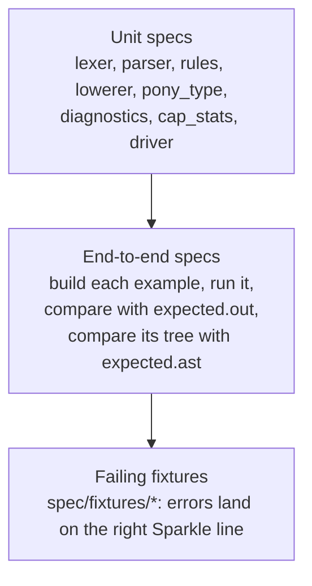
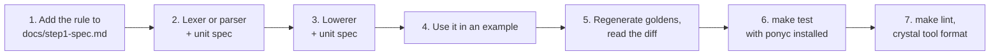

# Developing Sparkle

How to build, test and change this shard. For how it works, see [DESIGN.md](DESIGN.md).

## Dependencies

1. Make sure you have the Crystal toolchain installed, version 1.19 or later (`ameba` 1.7 needs it).
   - via `brew install crystal` for macOS and Linux (if you are so inclined)
   - or directly [install Crystal](https://crystal-lang.org/install/) from the website
2. `make` and `curl`. On Linux, also `lld` (for example `apt-get install lld`): the Pony compiler's own objects in `libponyc-standalone.a` are LLVM bitcode, which GNU `ld` cannot read.
3. The Pony compiler, `ponyc`. `make ponyc` fetches it; see below. It is needed to build Sparkle, not only to test it: `bin/sparkle` links its `libponyc-standalone.a`, and the shim compiles against the headers in the `vendor/ponyc` submodule.
4. Only to build `ponyc` from source: Clang, CMake 3.25 or later, Python 3, and the zlib and OpenSSL development headers.

Sparkle has no runtime shard dependencies. Its one development dependency is the linter, `ameba`.

## Build

### Dependency check

Run the following to install shards and build `ameba` the first time, or when dependencies change.

```sh
make ameba
```

### First time

```sh
git submodule update --init
```

```sh
make ponyc
```

```sh
make build
```

`make ponyc` downloads the prebuilt Pony release matching `vendor/ponyc/VERSION` into `.tools/ponyc`. It supports macOS and Linux, on Apple silicon/arm64 and x86-64.

Host  | Note
------|--------------------------------------------------------------------------------------------------------------------------------
macOS | Needs Xcode or its Command Line Tools (`xcode-select --install`), new enough to read the Pony release's LLVM bitcode: Xcode 26 for Pony 0.78.2. An older one fails to link `bin/sparkle` with "Invalid bitcode version"
Linux | Pony publishes builds per distribution. Set `PONYC_DISTRO` (for example `ubuntu24.04`) if yours is not detected or has no build

On any other host, use `make ponyc-source`.

### Actions

Command                          | Description
---------------------------------|------------------------------------------------------
`make build`                     | Build the translator into `bin/sparkle`
`make test`                      | Run all specs (`crystal spec`)
`crystal spec --order random`    | Run the specs in random order
`UPDATE_GOLDEN=1 crystal spec spec/e2e_spec.cr` | Rewrite every example's `expected.ast` (the lowered tree)
`make lint`                      | Lint all source code (`bin/ameba src spec`)
`make ameba`                     | Install shards and build `bin/ameba`, unless `shards check` passes and `bin/ameba` exists
`crystal tool format`            | Format all source code
`make ponyc`                     | Install the prebuilt `ponyc` into `.tools/`
`make ponyc-source`              | Build `ponyc` from the submodule (about an hour)
`make clean`                     | Remove `bin/sparkle` and `.sparkle/`; keeps `bin/ameba`
`make distclean`                 | As `clean`, and remove all of `bin/` and `.tools/` too
`bin/sparkle translate PATH`     | Print the lowered tree of a `.spk` file or directory, in ponyc's AST notation
`bin/sparkle run PATH [-- args]` | Translate, compile and run a `.spk` file or directory
`bin/sparkle caps PATH...`       | Count capability annotations per file

## Where things are

Path             | Holds
-----------------|-----------------------------------------------------------------
`src/sparkle/`   | The translator, one file per layer
`spec/`          | Test specs, mirroring `src/sparkle/*`
`spec/fixtures/` | Programs that must fail to compile, for the diagnostics specs
`examples/`      | Runnable programs, each with its golden tree and expected output
`docs/`          | The translation rules, and the `libponyc` spike's findings
`vendor/ponyc/`  | Pony, as a git submodule pinned to a release tag
`.tools/`        | The downloaded `ponyc` (not committed)
`lib/`           | Installed shards, which is only `ameba` (not committed)
`.sparkle/`      | Built binaries (not committed)

## Using `ops`

> Not required unless you are so inclined.

The `ops` tool provides an alternative way to define task recipes. It can be installed in one of the following ways:
  - as a gem via `gem install ops_team` or
  - as a tool via `brew tap nickthecook/crops && brew install ops`

The following `ops` actions wrap calls to `make` when the `Makefile` offers an action. CI workflow will have access to `make` and toolchains so they are the priority to maintain. Using `ops` is a convenience.

Command                | Description
-----------------------|-----------------------------------------------------------------------
`ops up`               | Gets everything setup, including shards, `ponyc`, submodule init, etc.
`ops lint`             | Run `ameba` on the source code
`ops build` or `b`     | Runs `make build`
`ops test`             | Runs `ops lint` first, then `make test`
`ops clean`            | Clears Crystal build caches and runs `make clean`
`ops run CRYSTAL_FILE` | Helper to run individual Crystal programs from source
`ops sparkle`          | Runs `bin/sparkle` assuming it's been built.

## Testing

### How the specs are arranged



Tier       | File                   | Needs a Pony installation
-----------|------------------------|--------------------------
Unit       | `spec/<layer>_spec.cr` | Only `rules`, `lowerer` and `driver`
End-to-end | `spec/e2e_spec.cr`     | Yes

The unit tier proves the translator produces the Pony we expect. The `rules` and `lowerer` specs write the expected Pony by hand and compare the lowered tree with ponyc's parse of it, so they need the compiler. The end-to-end tier proves that the examples compile and run, and holds the goldens. Each example has `expected.ast`, the lowered tree that the build compiles (what `sparkle translate` prints), and `expected.out`, the output of its run.

### Things that will bite you

- **Nothing builds before `make ponyc`.** `bin/sparkle` and the spec binary link the compiler from `.tools/ponyc`; without it the build stops and says so. End-to-end specs are still skipped, not failed, if no Pony installation is found at run time, and a run that reports pending specs has not checked that the generated Pony compiles.
- **`bin/sparkle` is about 160 MB and takes about 10 seconds to link**, because it holds the Pony compiler with LLVM.
- **`UPDATE_GOLDEN=1` accepts whatever the lowerer builds.** Read the diff of every `expected.ast` before committing it.
- **`expected.out` is maintained by hand.** Nothing regenerates it.
- **Actors run concurrently.** An example whose output order depends on message timing will fail now and then. Have one actor do all the printing, as `examples/ring` does.
- **`make ponyc-source` downloads Google Benchmark and GoogleTest from `github.com`.** On a restricted network that step fails, and the build with it.
- **The submodule's LLVM checkout is about 2.6 GB.** It is only fetched by `make ponyc-source`, never by `make ponyc`.

### Fixtures

Each directory under `spec/fixtures/` holds a `main.spk` that `ponyc` must reject. The end-to-end spec asserts on the rewritten error: the Sparkle file and line, the source excerpt, and types printed in Sparkle syntax.

Fixture          | Proves
-----------------|-------------------------------------------------------
`undefined_name` | An error is reported at the Sparkle line and column
`iso_mismatch`   | Capability and type errors print types the Sparkle way

## Working on the code

A change to the language usually touches the layers in order. Follow the same path.



1. Write the rule in [docs/step1-spec.md](docs/step1-spec.md) first: Sparkle on the left, Pony on the right.
2. Teach the lexer or parser the syntax, with a spec.
3. Teach the lowerer the translation, with a spec in `spec/rules_spec.cr`: the Sparkle, and the Pony it must lower to.
4. Use the feature in an example under `examples/`, or add a new one with `main.spk`, `expected.ast` and `expected.out`.
5. Run `UPDATE_GOLDEN=1 crystal spec spec/e2e_spec.cr` and read the golden diff.
6. Run `make test` with `ponyc` installed, so the end-to-end tier runs.
7. Run `make lint` and `crystal tool format`.

To see what a snippet becomes, use `bin/sparkle translate PATH`, which prints the lowered tree that `build` compiles. To read it as Pony, write the Pony you expect by hand and run `ponyc --pass=parse --astmodule` on it; the two trees should match. Do this when `ponyc` reports an error you do not understand.

Keep `vendor/ponyc` unmodified during step 1. To move to a newer Pony, check out the new release tag in the submodule, then run `make ponyc` and `make test`.

### Continuous integration

`.github/workflows/ci.yml` runs on every pull request and on every push to `main`, on Linux (`ubuntu-24.04`, x86-64) and macOS (`macos-26`, arm64, whose default Xcode 26 can read the Pony release's bitcode; `macos-15`'s newest Xcode cannot). It installs the prebuilt `ponyc` (cached per `vendor/ponyc/VERSION`) and builds `ameba` (cached with `lib/` per Crystal version and `shard.lock`), then runs the build, the specs, `make lint` and the format check. It fails if any spec is pending, so the end-to-end tier always runs.

### Keeping the documents current

Document                                 | Update it when
-----------------------------------------|------------------------------------------------------
[README.md](README.md)                   | What Sparkle is, why it exists, or its status changes
[DESIGN.md](DESIGN.md)                   | A layer, a decision or the "Not built" list changes
[docs/step1-spec.md](docs/step1-spec.md) | A translation rule or a known gap changes
[docs/spike-libponyc.md](docs/spike-libponyc.md) | A spike finding is confirmed or overturned
DEVELOPMENT.md                           | The way to build, test or lint changes
[HANDOFF.md](HANDOFF.md)                 | A piece of work ends: rewrite it, do not append
[.claude/](.claude)                      | The way work is delegated, or a review yields a lesson for `implementer.md`

## Contributions

By invitation only for the time being.
