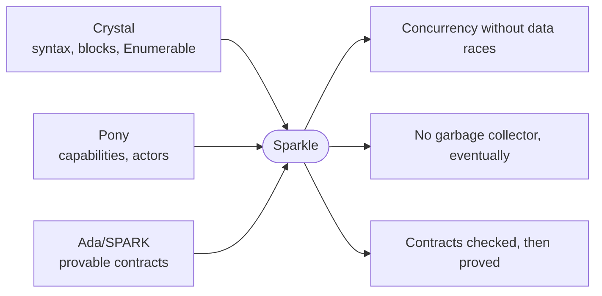

# Sparkle

An experimental compiled language: Crystal's syntax and Ruby-style idioms, on top of Pony's reference capabilities and actors.

```crystal
actor Worker
  @stream : OutStream

  def self.new(env : Env)
    @stream = env.@out
  end

  be process(names : iso Array(String))
    sealed : val Array(String) = consume names
    sealed.each do |name|
      @stream.print("hello, #{name}")
    end
  end
end

actor Main
  def self.new(env : Env)
    names = recover iso do Array(String).new end
    names << "ada"
    Worker.new(env).process(consume names)
  end
end
```

## Why

Crystal reads well but shares memory between fibres and leans on a garbage collector. Pony makes data races a compile error and has actors built in, but its syntax is unfamiliar and its capability defaults are demanding. Sparkle is a bet that the two can be combined:



| Goal | Meaning |
|---|---|
| Familiar syntax | `def … end`, blocks, `Enumerable`, string interpolation |
| Safe concurrency | Pony's `iso`, `val`, `ref` and friends, with actors as the unit of concurrency |
| Small, predictable runtime | No garbage collector in the end state, without passing arenas around by hand |
| Provable contracts | `requires`, `ensures` and `invariant`, checked at runtime first and proved where possible |

## Status

Early, and it may not work out. Today Sparkle is a translator: it turns `.spk` source into Pony and hands that to the unmodified Pony compiler. There is no toolchain to install yet.

| Document | Read it for |
|---|---|
| [DESIGN.md](DESIGN.md) | How the translator is put together, the decisions behind it, and the roadmap |
| [DEVELOPMENT.md](DEVELOPMENT.md) | Building, testing and changing it |
| [docs/step1-spec.md](docs/step1-spec.md) | Every Sparkle-to-Pony translation rule |
| [examples/](examples) | Working programs |

## Licence

[MPL-2.0](LICENSE).
