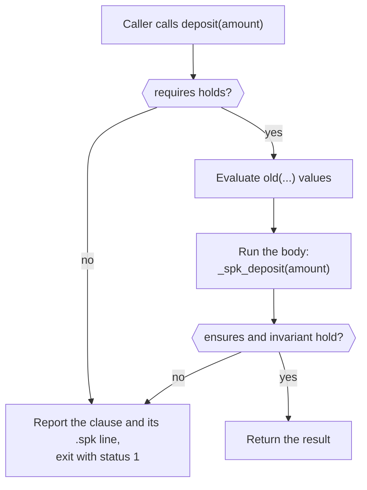

# Contracts: a design proposal

How contracts look in Sparkle, what they mean, and how they lower to Pony. It is a proposal: the choices marked **Decision** are open. Roadmap step 3 builds runtime checks; step 7 proves them. Two facts were checked against Pony 0.78.2 first: a lowered check can report a failure and exit through FFI that Sparkle emits itself, without offering FFI to users; and a contract evaluated through a `box` view of `self` cannot call a `ref` method, so ponyc itself keeps contracts free of state changes.

## What they look like

```crystal
class Account
  @balance : Int64 = 0

  invariant @balance >= 0

  requires amount > 0
  ensures @balance == old(@balance) + amount
  def ref deposit(amount : Int64)
    @balance += amount
  end

  requires amount > 0, amount <= @balance
  ensures result == amount
  def ref withdraw(amount : Int64) : Int64
    @balance -= amount
    amount
  end

  def balance : Int64 = @balance
end
```

| Clause | Where | Checked | A failure means |
|---|---|---|---|
| `requires cond, …` | before a `def` or `be` | on entry, after the arguments are bound | the caller broke the contract |
| `ensures cond, …` | before a `def` | on every normal return | the method broke its promise |
| `invariant cond` | in a type's body | after each constructor, and around each `ref` method and behaviour | the type broke its own rule |

- `result` in `ensures` is the method's return value.
- `old(expr)` is `expr` evaluated on entry, before the body runs.
- Several conditions in one clause are joined by `and`; each is reported on its own.

Prior art: Eiffel's `require`, `ensure`, `invariant` and `old`; Ada and SPARK's `Pre`, `Post` and `'Old`; D's `in` and `out`; Dafny's `requires` and `ensures`. Crystal has none, so there is no idiom to copy; clauses written before the `def`, like annotations, keep the body as Crystal would have it.

## How they lower

A contracted method becomes two: the body, renamed, and a wrapper with the original name that checks around it. Every call, including recursive ones, goes through the wrapper.



```pony
fun ref deposit(amount: I64) =>
  let view: Account box = this
  if not (amount > 0) then _SpkContract.fail("main.spk:7: requires amount > 0") end
  let old_balance = view._balance
  _spk_deposit(amount)
  if not (view._balance == (old_balance + amount)) then _SpkContract.fail("main.spk:8: ensures ...") end
  if not (view._balance >= 0) then _SpkContract.fail("main.spk:4: invariant @balance >= 0") end
```

- **Read-only by construction.** Every condition is evaluated through `view`, a `box` alias of `self`, and arguments are seen as `box` too. Calling a `ref` method from a contract is then a type error from ponyc, not a convention. One hole remains: a `box` method may still send a message to an actor. Rejecting behaviour calls in contracts closes it.
- **Failure** prints the clause and its Sparkle line on standard error and exits with status 1, through `fprintf` and `exit` declared with Pony FFI in the generated code. It never becomes a Pony `error`, so contracts never change which methods are partial.
- **`old(expr)`** must have a type that can be kept unchanged: a number, `Bool`, or anything `val`. `old(@items)` on a `ref` array would keep a reference, not a snapshot, and would silently compare the array with itself, so it is an error; write `old(@items.size)`. `old` of an `iso` is an error too, because keeping it would alias it.

## Capabilities and actors

| Case | Rule |
|---|---|
| `box` method | Cannot change `self`, so its invariant is not rechecked |
| `ref` method | Invariant checked after it returns; before it as well, which catches a broken object early but costs twice |
| Constructor | `requires` on entry; invariant on exit; `ensures` may name the new object's fields |
| Behaviour (`be`) | `requires` is checked when the message is processed, in the receiving actor, not when it is sent: the sender never waits. `ensures` is not allowed, because no caller sees the end. The invariant is checked after each behaviour |
| Partial method (`!`) | `ensures` holds only on normal return; when it fails, no promise is made |
| Yielding method | Clauses are copied with the body into each call; `ensures` cannot see a block's effects, so only `requires` is allowed for now |

Actors suit invariants well. An actor's state changes only inside its behaviours, one message at a time, so an invariant checked after each behaviour holds whenever any other actor could observe it.

## Release builds

**Decision:** what `--release` keeps.

| Option | Trade-off |
|---|---|
| All checks, always | Safest; costs time on every call, about two branches per clause |
| `requires` only | Callers stay protected; the type's own promises are trusted once tested. Eiffel's common choice |
| None | Fastest; a bug is then silent in production |

Recommendation: `requires` only, with a flag such as `--contracts=all` to keep everything.

## What proving needs (step 7)

Contracts written now should be provable later, which constrains the language of conditions, not the syntax:

- Conditions should call only methods that are themselves free of effects. `box` gives that for `self`; a proof also needs it for every call, so step 7 may add a `pure` marker, or infer it.
- Quantifiers will be Enumerable blocks: `(0...n).all? { |i| @items[i]! >= 0 }`. With `yield` inlined, an SMT encoding can read the block as the formula.
- Pony's capabilities help: an `iso` or `val` cannot be aliased and changed behind a proof's back, which is the hard part of proving imperative code.

## Decisions for the user

1. **Syntax**: clauses before the `def` (shown above), or inside it, after the signature, as Eiffel does. Before the `def` keeps a Crystal body unchanged and reads like an annotation.
2. **Release builds**: see above; recommended: `requires` only.
3. **Invariants around `ref` methods**: after only (cheaper), or before and after (catches more).
4. **Failure**: exit with a message, as proposed, or raise a Pony `error`, which a caller could recover from but which makes every contracted method partial.

## Building it

1. Parse `requires`, `ensures`, `invariant`, `old` and `result`; a spec section first.
2. Lower contracted methods to a wrapper and a body, with the `box` view, the FFI failure and `old` values. Errors in clauses are reported at their `.spk` lines.
3. Invariants, constructors and behaviours.
4. `--release` handling, and the skill's reference page.
