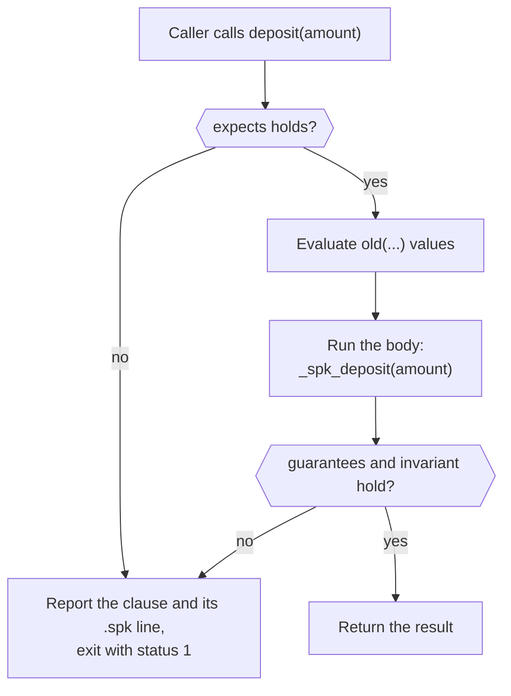

# Contracts: a design proposal

How contracts look in Sparkle, what they mean, and how they lower to Pony. The decisions are settled; they are listed at the end. Roadmap step 3 builds runtime checks; step 7 proves them. Two facts were checked against Pony 0.78.2 first: a lowered check can report a failure and exit through FFI that Sparkle emits itself, without offering FFI to users; and a contract evaluated through a `box` view of `self` cannot call a `ref` method, so ponyc itself keeps contracts free of state changes.

## What they look like

**A clause follows the declaration it constrains, before that declaration's body.** A method's clauses sit with its parameters and return type, as in Dafny; a type's invariants sit at the top of the type.

```crystal
class Account
  maintains @balance >= 0

  @balance : Int64 = 0

  def ref deposit(amount : Int64)
    expects amount > 0
    guarantees @balance == old(@balance) + amount

    @balance += amount
  end

  def ref withdraw(amount : Int64) : Int64
    expects amount > 0, amount <= @balance
    guarantees result == amount

    @balance -= amount
    amount
  end

  def balance : Int64 = @balance
end
```

| Clause | Where | Checked | A failure means |
|---|---|---|---|
| `expects cond, …` | first lines of a `def` or `on` | on entry, after the arguments are bound | the caller broke the contract |
| `guarantees cond, …` | first lines of a `def`, after any `expects` | on every normal return | the method broke its promise |
| `maintains cond` | first lines of a `class` or `actor`, before any field or method | after each constructor, and around each `ref` method and behaviour | the type broke its own rule |

- The body starts at the first line that is not a clause. No separator is needed, because a clause keyword cannot start a statement.
- A clause anywhere else is an error, so an invariant cannot drift into the middle of a type.
- A method with clauses uses the long form, `def … end`; `def x : T = expr` takes none.
- `result` in `guarantees` is the method's return value.
- `old(expr)` is `expr` evaluated on entry, before the body runs.
- `result` and `old` are keywords only inside `guarantees`, so a local named `result` elsewhere is unaffected.
- Several conditions in one clause are joined by `and`; each is reported on its own.

The words are verbs whose subject is the method or the type: `withdraw` expects and guarantees; `Account` maintains. They are not Dafny's `requires` and `ensures`, because `ensures` is one letter from `ensure`, which already runs cleanup code in `begin … rescue … ensure`. `maintains` covers both halves of an invariant: a constructor makes it true, and each method keeps it true. The rule it states is still called an invariant. Prior art: Eiffel's `require`, `ensure`, `invariant` and `old`; Ada and SPARK's `Pre`, `Post` and `'Old`; D's `in` and `out`; Dafny's `requires`, `ensures` and `invariant`, whose placement Sparkle follows.

## How they lower

A contracted method becomes two: the body, renamed, and a wrapper with the original name that checks around it. Every call, including recursive ones, goes through the wrapper.



```pony
fun ref deposit(amount: I64) =>
  let view: Account box = this
  if not (amount > 0) then _SpkContract.fail("main.spk:8: expects amount > 0") end
  let old_balance = view._balance
  _spk_deposit(amount)
  if not (view._balance == (old_balance + amount)) then _SpkContract.fail("main.spk:9: guarantees ...") end
  if not (view._balance >= 0) then _SpkContract.fail("main.spk:2: maintains @balance >= 0") end
```

- **Read-only by construction.** Every condition is evaluated through `view`, a `box` alias of `self`, and arguments are seen as `box` too. Calling a `ref` method from a contract is then a type error from ponyc, not a convention. One hole remains: a `box` method may still send a message to an actor. Rejecting behaviour calls in contracts closes it.
- **Failure** prints the clause and its Sparkle line on standard error and exits with status 1, through `fprintf` and `exit` declared with Pony FFI in the generated code. It never becomes a Pony `error`, so contracts never change which methods are partial.
- **`old(expr)`** must have a type that can be kept unchanged: a number, `Bool`, or anything `val`. `old(@items)` on a `ref` array would keep a reference, not a snapshot, and would silently compare the array with itself, so it is an error; write `old(@items.size)`. `old` of an `iso` is an error too, because keeping it would alias it.

## Capabilities and actors

| Case | Rule |
|---|---|
| `box` method | Cannot change `self`, so its invariant is not rechecked |
| `ref` method | Invariant checked after it returns. Not before: every way in is already checked on its way out |
| Constructor | `expects` on entry; invariant on exit; `guarantees` may name the new object's fields |
| Behaviour (`on`) | `expects` is checked when the message is processed, in the receiving actor, not when it is sent: the sender never waits. `guarantees` is not allowed, because no caller sees the end. The invariant is checked after each behaviour |
| Partial method (`!`) | `guarantees` holds only on normal return; when it fails, no promise is made |
| Yielding method | Clauses are copied with the body into each call; `guarantees` cannot see a block's effects, so only `expects` is allowed for now |

Actors suit invariants well. An actor's state changes only inside its behaviours, one message at a time, so an invariant checked after each behaviour holds whenever any other actor could observe it.

## Release builds

A debug build checks every clause. `--release` keeps only `expects`: callers stay protected, and the type's own promises are trusted once tested, which is Eiffel's common choice. `--contracts=all` keeps everything in a release build.

| Build | `expects` | `guarantees` | `maintains` |
|---|---|---|---|
| debug (default) | checked | checked | checked |
| `--release` | checked | — | — |
| `--release --contracts=all` | checked | checked | checked |

## What proving needs (step 7)

Contracts written now should be provable later, which constrains the language of conditions, not the syntax:

- Conditions should call only methods that are themselves free of effects. `box` gives that for `self`; a proof also needs it for every call, so step 7 may add a `pure` marker, or infer it.
- Quantifiers will be Enumerable blocks: `(0...n).all? { |i| @items[i]! >= 0 }`. With `yield` inlined, an SMT encoding can read the block as the formula.
- Loop invariants will use the same word, as the first lines of a loop: `while i < n` then `maintains 0 <= i, i <= n`.
- Pony's capabilities help: an `iso` or `val` cannot be aliased and changed behind a proof's back, which is the hard part of proving imperative code.

## Parked

- **Invariants on a field** (`@balance : Int64 = 0` with a clause under it). A rule over two fields belongs to neither, so the type-level invariant comes first; the field form would be sugar for it.
- **Constrained types**, Dafny's subset types: `alias Balance = Int64 where self >= 0`. The rule travels with the value and replaces many `expects` clauses (`def withdraw(amount : Positive)`), but Pony has no such types, so a runtime check would run at every assignment and call. Revisit with step 7.

## Decisions

1. **Syntax**: clauses are the first lines of the declaration they constrain, with no separator before the body.
2. **Words**: `expects`, `guarantees`, `maintains`; they may change once used in practice.
3. **Invariants**: on a type only, for now.
4. **Release builds**: `expects` only; `--contracts=all` keeps everything.
5. **Invariants around `ref` methods**: checked after only. Revisit if a case turns up where one method's exit is not the next one's entry.
6. **Failure**: print the clause and its `.spk` location, exit with status 1. Never a Pony `error`.

## Building it

Built in step 3, as one change: parsing, the wrapper and body with the `box` view, the FFI failure and `old` values, invariants, constructors and behaviours, `--release` handling, and the skill's [contracts](../skills/sparkle/reference/contracts.md) page. The rules as built are in [step1-spec.md](step1-spec.md), *Contracts (step 3)*. Not yet: clauses on yielding, abstract and `tag` methods, and `maintains` in traits, interfaces and primitives.
