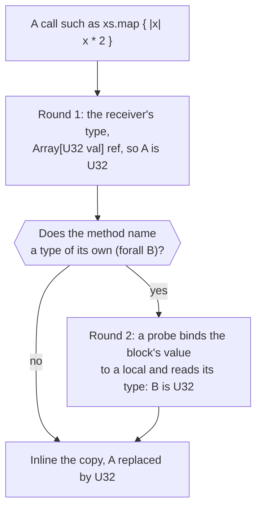

# Enumerable: a design proposal

How Crystal's collection methods, `map`, `select`, `sum` and the rest, come to Pony's `Array` and other collections, written in Sparkle in the library's `prelude`. The decisions are settled; they are listed below. Two facts were checked first, with the unmodified Pony 0.78.2 ([`spike/enumerable/probe.cr`](../spike/enumerable/probe.cr)): a type-check round can tell the type of a block's value, and Pony's `Array` already has methods that a Crystal programmer would call by the same name with another meaning.

## What it looks like

```crystal
xs = [1, 2, 3]
doubled = xs.map { |x| x * 2 }
big = xs.select { |x| x > 1 }
env.out <~ print("#{xs.sum} #{doubled} #{big.size} #{xs.any? { |x| x > 2 }}")
```

The prelude says it in Sparkle:

```crystal
module Enumerable(A)
  def map(&block : A -> B) : Array(B) forall B
    result = [] of B
    values.each do |x|
      result << yield x
    end
    result
  end

  def select(&block : A -> Bool) : Array(A)
    result = [] of A
    values.each do |x|
      result << x if yield x
    end
    result
  end

  def sum : A
    total : A = 0
    values.each do |x|
      total += x
    end
    total
  end
end

class Array(A)
  include Enumerable(A)
end
```

- **Inline only.** Every method in the prelude's `Enumerable`, and every method added to a Pony type, is copied into each call, as a yielding method is today, with or without a block. Nothing is compiled into Pony's `Array`; a method that is never called costs nothing.
- **Written against Pony's API.** `values` is Pony's iterator; the copy reaches only what any caller could, so it cannot break a type's own rules.
- **Other collections** get the same methods by one line each: `class List(A)`, `class Set(A)`, each `include Enumerable(A)`.

## How it works



1. **Which method.** As for yielding methods today, the receiver's type decides: `Array[U32 val] ref` names `Array`, whose methods include `Enumerable`'s. A type with no such method is lowered as now.
2. **Element type.** The receiver's type arguments give the type's parameters: `A` is `U32`. The copy's types are written out with it, so `[] of A` becomes `Array[U32]`.
3. **The block's type.** Pony cannot infer a type argument, so `map`'s `Array(B)` needs `B` written out. A method that names a type of its own, `forall B`, gets one more type-check round. The site is lowered as a loop over an empty array of the block's parameter types, whose body binds the block's value to a probe local:

   ```pony
   for x in Array[U32].create().values() do
     let spk_probe_1 = x * 2
   end
   ```

   After ponyc's expression pass, the probe's declared type is `B`: here `U32 val`. The spike read `U32 val`, `Bool val` and `(String val, USize val)` this way. The loop never runs: it exists only in a type-check round.
4. **Rounds.** One round for the receiver, as now, and one more for a site that needs `B`. The standard library is loaded once per build, so each extra round costs under 0.1 s.

## Names Pony's `Array` already has

| Name | Pony means | Crystal means |
|---|---|---|
| `find` | `find(value)`: the index of a value, partial | `find { … }`: the first element the block accepts, or `nil` |
| `delete` | `delete(i)`: remove at an index | `delete(value)`: remove every equal element |
| `reverse` | a new reversed array | the same |
| `contains` | whether a value is present | Crystal calls it `includes?` |
| `values`, `keys`, `pairs` | iterators | Crystal has `each`, `each_with_index` instead |

## Decisions

1. **Reopening Pony's types**: `class Array(A)` adds to Pony's `Array`, as in Crystal, limited to inline-only methods: no fields, no constructors, nothing compiled into the type, only its public API. So a reopened type gains no state and no code, and its contracts still hold. This answers DESIGN.md's open question on reopening types for Pony's types; reopening a Sparkle type stays unsupported.
2. **Clashing names**: the prelude's meaning wins, so `find { … }` and `delete(value)` mean what they mean in Crystal. `delete_at(i)` and `index(value)` give Pony's `delete` and `find`.
3. **The block's type**: Crystal's `def map(&block : A -> B) : Array(B) forall B`.
4. **The first set**: `map`, `select`, `reject`, `find`, `any?`, `all?`, `none?`, `count`, `sum`, `reduce`, `includes?`, `index`, `first?`, `min`, `max`, `join`, `each_with_index` (today's loop sugar, kept), and `delete_at`. Later: `sort_by`, `group_by`, `each_slice`, `zip`.

## What the language needs first

- **Calls without a block** to an inline-only method, `xs.sum`, are copied too; today only calls with a block are.
- **`&block : A -> B` and `forall B`** in a method's signature, parsed and used to type the copy.
- **Type substitution** in the copy: the type's parameters from the receiver, and `forall` names from the probe.
- **`next` and `break` in a block whose call's value is used** (step 2's gap), so that `xs.map { |x| next 0 if x < 0; x }` works.

## Building it

1. Spec sections for reopening Pony types, `forall`, and inline-only calls without a block.
2. Parsing; the inliner's element-type substitution and calls without a block.
3. The probe round and `forall` substitution.
4. `stdlib/prelude/enumerable.spk` and `array.spk` with the first set of methods; an example; the skill's page on collections.
5. The step-2 gap, `next` and `break` where the value is used.

Steps 4 and parts of 1 suit the `implementer`: writing the library's methods against a fixed pattern, their specs, and the skill page.
