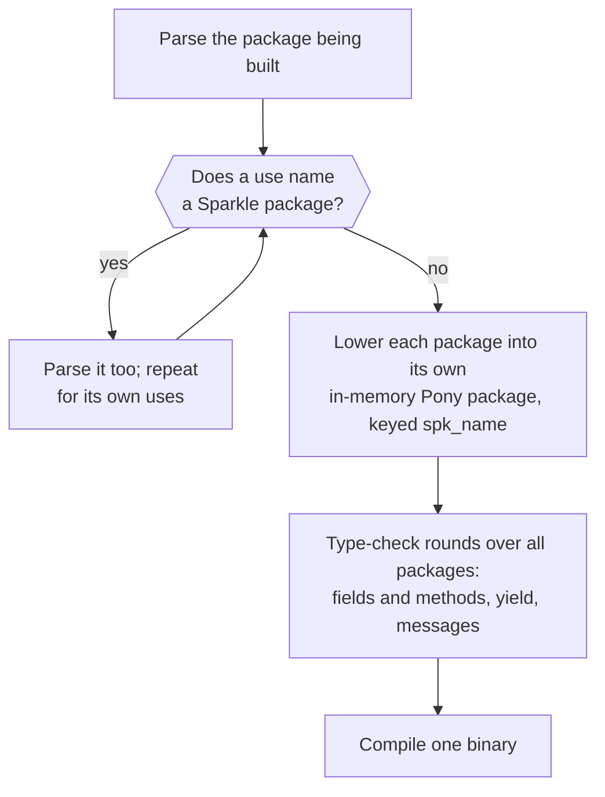

# Packages: a design proposal

How one Sparkle package uses another, so that step 4's Enumerable and Array can live in a Sparkle library rather than in the translator. It is a proposal: the choices marked **Decision** are open. One fact was checked first, with the unmodified Pony 0.78.2 ([`spike/packages/two.cr`](../spike/packages/two.cr)): two Sparkle packages, each lowered into its own in-memory Pony package, one using the other, compile to one binary that runs.

## What it looks like

```text
app/
  main.spk          use "./geometry"
  geometry/
    point.spk       class Point …
    shapes.spk      class Circle …
```

```crystal
use "./geometry"

actor Main
  def self.new(env : Env)
    p = Point.new(3, 4)
    env.out <~ print("#{p.length}")
  end
end
```

- **A package is a directory** of `.spk` files, as today: `sparkle build app` builds `app` and every package it uses.
- **`use "./geometry"`** names a directory relative to the file's own. `use "collections"` (no `./`) still names a library: Sparkle's first, then Pony's.
- **Every public name of the package comes into scope**, as with Pony's `use` and Crystal's `require`. A name starting with `_` stays private to its package, as today.

## How it works



1. **Finding packages.** Each `use` is resolved when parsing: a relative path to a directory of `.spk` files is a Sparkle package; a name is looked up in the Sparkle library directory, then left to ponyc as a Pony package. A cycle is an error that names it.
2. **Lowering.** Each Sparkle package becomes one in-memory package, registered with ponyc under a key such as `spk_geometry`, and the `use` in the lowered tree names that key. ponyc finds an in-memory package by the exact text of the `use`, before it searches any path. The key cannot contain `:`, which ponyc reads as a scheme (`lib:`); two packages whose directories share a name get a numbered key.
3. **Rounds.** The field-or-method loop, `yield` inlining, contracts and the `<~` check already work per file. They run over every file of every package, in one compiler session, as now. Errors are reported at each file's own path.
4. **Yielding methods across packages.** A yielding method is copied into its callers, so a copy can land in another package. Today the copy reads fields through accessors named `_yf_items`, which Pony keeps private to the package. Across packages the accessor must be public, under a name Sparkle code cannot declare: `spk_yf_items`. Pony allows no character in a method name that Sparkle's syntax lacks (a trailing prime is refused), so the prefix `spk_` is reserved: declaring a name that starts with it is an error. Generated locals already use it (`spk_view`, `spk_r1`).

## The Sparkle library

Step 4 needs a place for Sparkle's own library, written in Sparkle:

| Where | Holds |
|---|---|
| `lib/sparkle/` in the repository | The library's packages, each a directory of `.spk` files |
| `share/sparkle/lib/` in an installation | The same, copied by `make install` |

Enumerable then becomes yielding methods on Pony's own `Array`, inlined at each call. A method of the library is never compiled on its own, so it costs nothing unless it is used.

## Decisions for the user

1. **The word.** Keep `use`, which matches what it does: it imports a package, a directory with its own private names. Or `require`, which is Crystal's word, but in Crystal it textually includes a file into one global namespace, with no package privacy. Recommended: keep `use`; a Crystal reader meets one new word, and it does not promise Crystal's meaning.
2. **A prelude.** Should part of the Sparkle library come into scope without a `use`, as Pony's `builtin` does and Crystal's whole standard library does? Recommended: yes, one package, `prelude`, holding what Crystal programmers expect everywhere, such as `Array#map`, `select` and `sum`. Everything else needs a `use`.
3. **Qualified names.** Pony allows `use g = "geometry"` and then `g.Point`; Crystal would write `Geometry::Point` inside a `module`. Recommended: not now. Bring every public name into scope, and add an alias form when a name clash first demands one.
4. **The reserved prefix.** `spk_` for names Sparkle generates, refused in user code. Recommended: yes; the alternative, mangled names with characters Sparkle cannot write, is not available in Pony.

## Building it

1. A spec section, then resolving and parsing used Sparkle packages, with cycle detection.
2. Lowering each package into its own in-memory package, in the session and in the compile; errors at each file's path.
3. Public accessors for yielding methods used across packages, and the reserved prefix.
4. The library directory, `make install` copying it, and the prelude if decision 2 says so.
5. Examples, the skill's page on packages, and goldens.

Steps 3 to 5 have mechanical parts, such as the spec cases, examples and skill page, which suit the `implementer` subagent once the rules are fixed.
