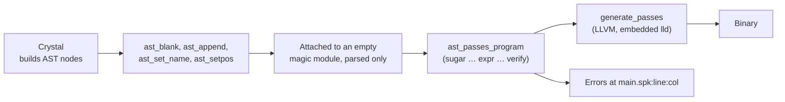

# Spike: linking `libponyc` from Crystal

The question from DESIGN.md's [One binary](../DESIGN.md#one-binary): can the Crystal front end link `libponyc` and build its AST directly, instead of writing Pony text and running `ponyc`? **Yes.** The code is in [`spike/libponyc/`](../spike/libponyc), and was tested on Linux x86-64 with Pony 0.78.2.

## Results

| Stage | What it shows | Result |
|---|---|---|
| 1 | Link, `ponyc_init`, `ponyc_shutdown` | Works |
| 2 | Compile Pony text held in memory, in-process, to a binary | Works; the binary runs |
| 3 | Build the AST in Crystal, compile it, run it | Works; the tree prints identically to the parser's |
| 3, with an error | Nodes carry `.spk` positions | `main.spk:3:13: couldn't find 'prnt' in 'OutStream'`, with the Sparkle line and a caret |

Run `spike/libponyc/build.sh`, then `build/stage1`, `build/stage2`, `build/stage3` and `build/stage3 bad`.

## What it takes

- **Linking:** the prebuilt release already ships `libponyc-standalone.a`, which is `libponyc` with LLVM, lld and clang inside, so nothing is built from source. It needs `libponyrt-pic.a` beside it, because the compiler uses the runtime's data structures, plus `-lz -ldl -lpthread -lm`.
- **A C shim of about 50 lines** ([`shim.c`](../spike/libponyc/shim.c)). `pass_opt_t` is a large struct, so the shim sets the five options that matter: output directory, binary name, pass limit, release and `argv0`. Token kinds and pass ids are C enums, so it also exports their values. Everything else is called directly from Crystal.
- **Injecting the AST:** register an empty magic module, load it with the pass limit at `PASS_PARSE`, append the hand-built nodes to its file node, then raise the limit and run `ast_passes_program` and `generate_passes`. Passes are recorded per node, so they resume. Because the nodes enter at the parse level, Pony's own sugar pass still runs on them.
- **Positions:** a `source_t` whose `file` is `main.spk` and whose text is the Sparkle source, set on each node with `ast_setpos`. `ponyc` then reports errors against the `.spk` file and quotes its line. No source map is needed.

## Things that will bite

- **Magic module paths are compared by pointer.** Pass `program_load` the string interned by `stringtab`, not a fresh copy, or it reports "couldn't locate this path".
- **Search paths are relative to the executable.** `ponyc` finds `packages/` and `lib/<arch>/` from its own location. An embedding binary sets `PONYPATH` to both.
- **The AST shape is internal and moves.** In 0.78.2 a package is `TK_MODULE` and a source file is `TK_FILE`. The builder has to mirror the parser's output exactly, scope flags included, and must be re-checked on every Pony upgrade. `ponyc --pass=parse --astmodule` prints the shape to copy.

## Costs

| Measure | Value |
|---|---|
| Binary size | 160 MB (`ponyc` itself is 151 MB) |
| Link time | 15 s cold, 5 s warm |
| Compile of the hello program | 2.04 s in-process, 2.08 s as a `ponyc` subprocess |

Starting a second process costs almost nothing; LLVM's code generation dominates. One binary is worth having for the positions and the AST, not for speed.

## Not tested

- **macOS.** The archive lives under `lib/arm64`, and on macOS it needs `libc++` and `libz` linked separately, as ponyc's CMake notes.
- **Reading types back out after `PASS_EXPR`.** That is what step 2's rules need, for example to tell a field from a call.
- **Types in error messages** still print in Pony's syntax (`String val`, not `val String`), so a type printer is still needed.
- **More than one module, and `use`.**

## What it means for the plan

The plan holds, and two parts of it look lighter than DESIGN.md assumed:

1. Errors against `.spk` files need no fork, only positions on the nodes.
2. Building the AST needs no fork either. A fork is needed only for behaviour `ponyc` lacks, such as `yield` inlining.

That raises a question for step 2: could rules that need types be written in Crystal, by reading the typed AST after `PASS_EXPR` and rewriting it, before any C patches? Field-versus-call resolution is the obvious candidate.
