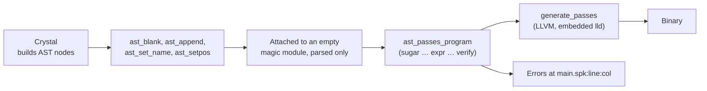
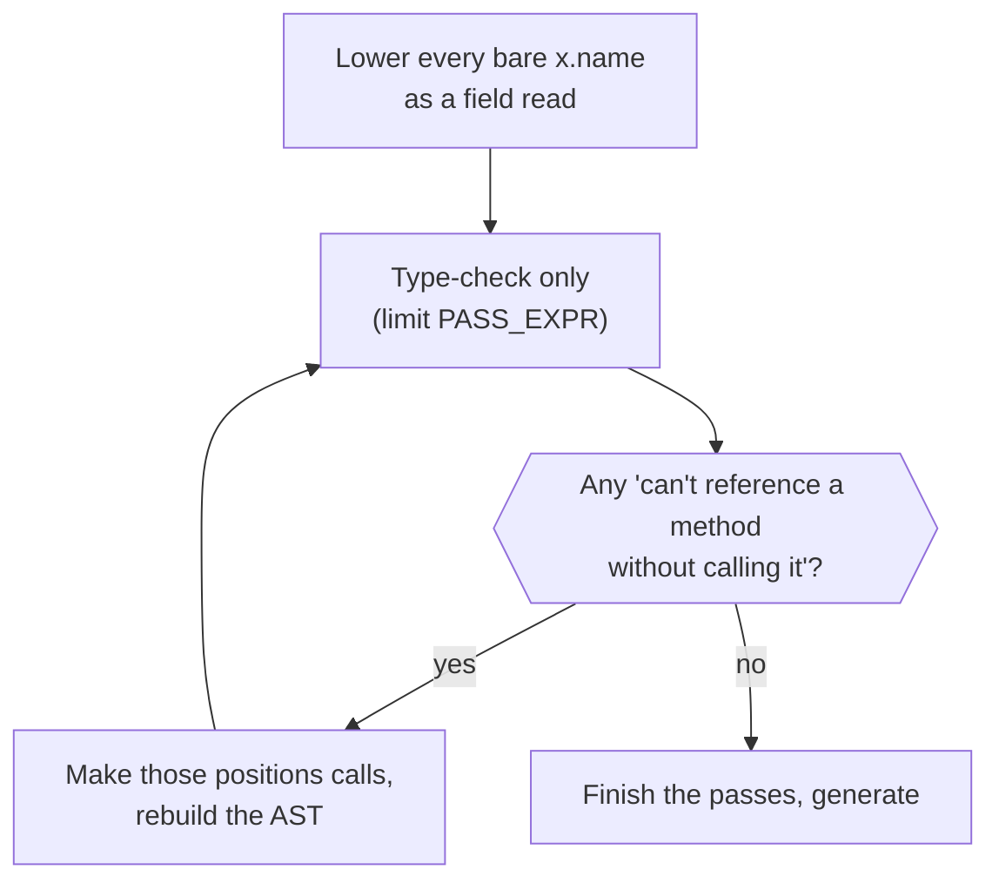

# Spike: linking `libponyc` from Crystal

The question from DESIGN.md's [One binary](../DESIGN.md#one-binary): can the Crystal front end link `libponyc` and build its AST directly, instead of writing Pony text and running `ponyc`? **Yes.** The code was [`spike/libponyc/`](https://github.com/nogginly/sparkle/tree/747866f47de5a62a87767e660f879d8285c4025d/spike/libponyc), removed once its stages had graduated or been recorded here, and was tested on Linux x86-64 with Pony 0.78.2.



## Results

| Stage | What it shows | Result |
|---|---|---|
| 1 | Link, `ponyc_init`, `ponyc_shutdown` | Works |
| 2 | Compile Pony text held in memory, in-process, to a binary | Works; the binary runs |
| 3 | Build the AST in Crystal, compile it, run it | Works; the tree prints identically to the parser's |
| 3, with an error | Nodes carry `.spk` positions | `main.spk:3:13: couldn't find 'prnt' in 'OutStream'`, with the Sparkle line and a caret |
| 4 | Tell a field from a method using types, and read types back | Works: three rounds of type checking, then a running binary |

To rerun it, restore it with `git checkout 747866f -- spike/libponyc`, run `spike/libponyc/build.sh`, then `build/stage1`, `build/stage2`, `build/stage3`, `build/stage3 bad` and `build/stage4`.

## Stage 4: fields and methods, decided by types

Step 1 emits every `x.name` as a call, because without types it cannot tell a field from a method; hence `env.@out`. Stage 4 takes `env.out.print(env.args.size.string)`, with no `@` and no parentheses, and lets `ponyc` decide:



```
round 1 (0.13s): 2 errors; methods at 3:27
round 2 (0.2s): 2 errors; methods at 3:32
round 3 (0.14s): 0 errors; methods at none
  call at 3:32 has type String val
  call at 3:27 has type USize val
```

- **It settles in one round per link of a method chain.** `.size` can only be judged once `env.args` has a type, and `.string` once `.size` is a call. Fields such as `.out` and `.args` are never touched. Independent expressions settle in the same rounds.
- **Errors are read as data.** `errors_get_first` gives each error's file, line, column and message, so the loop matches positions, not text it has to parse out of the terminal.
- **The default has to be "field".** Calling a field is not an error Pony can report clearly: `env.out()` means `env.out.apply()`, so it fails with "couldn't find 'apply'", or compiles silently if the field's type has an `apply()`. A method referenced without a call, by contrast, always gives the one error above.
- **Types can be read back.** `ast_type` and `ast_print_type` give each expression's type after `PASS_EXPR`. The type is also an AST, so a printer in Sparkle's syntax can walk it instead of rewriting text.
- **A round costs about 0.15 s**, because each one reloads `builtin`. Code generation, which runs once, is still the 2 seconds that matter. Later measured: a program that uses `collections` costs about 2.4 s a round, since every round reloads every package.


## What it takes

- **Linking:** the prebuilt release already ships `libponyc-standalone.a`, which is `libponyc` with LLVM, lld and clang inside, so nothing is built from source. It needs `libponyrt-pic.a` beside it, because the compiler uses the runtime's data structures, plus `-lz -ldl -lpthread -lm`.
- **A C shim of about 50 lines** ([`shim.c`](https://github.com/nogginly/sparkle/blob/747866f47de5a62a87767e660f879d8285c4025d/spike/libponyc/shim.c)). `pass_opt_t` is a large struct, so the shim sets the five options that matter: output directory, binary name, pass limit, release and `argv0`. Token kinds and pass ids are C enums, so it also exports their values. Everything else is called directly from Crystal.
- **Injecting the AST:** register an empty magic module, load it with the pass limit at `PASS_PARSE`, append the hand-built nodes to its file node, then raise the limit and run `ast_passes_program` and `generate_passes`. Passes are recorded per node, so they resume. Because the nodes enter at the parse level, Pony's own sugar pass still runs on them.
- **Positions:** a `source_t` whose `file` is `main.spk` and whose text is the Sparkle source, set on each node with `ast_setpos`. `ponyc` then reports errors against the `.spk` file and quotes its line. No source map is needed.

## Things that will bite

- **Magic module paths are compared by pointer.** Pass `program_load` the string interned by `stringtab`, not a fresh copy, or it reports "couldn't locate this path".
- **Search paths are relative to the executable.** `ponyc` finds `packages/` and `lib/<arch>/` from its own location. An embedding binary sets `PONYPATH` to both.
- **LLVM's crash handlers take the garbage collector's signals.** `ponyc_init` calls `LLVMEnablePrettyStackTrace`, whose handlers cover `SIGXCPU`, which Crystal's Boehm GC uses on Linux to resume paused threads. The first such signal prints LLVM's "PLEASE submit a bug report" banner before LLVM passes it on. `src/sparkle/ponyc/shim.c` restores the collector's handlers after `ponyc_init`; LLVM installs its handlers only once per process, so they stay out of the way.
- **The AST shape is internal and moves.** In 0.78.2 a package is `TK_MODULE` and a source file is `TK_FILE`. The builder has to mirror the parser's output exactly, scope flags included, and must be re-checked on every Pony upgrade. `ponyc --pass=parse --astmodule` prints the shape to copy.

## Costs

| Measure | Value |
|---|---|
| Binary size | 160 MB (`ponyc` itself is 151 MB) |
| Link time | 15 s cold, 5 s warm |
| Compile of the hello program | 2.04 s in-process, 2.08 s as a `ponyc` subprocess |

Starting a second process costs almost nothing; LLVM's code generation dominates. One binary is worth having for the positions and the AST, not for speed.

## Not tested

- **macOS.** The release keeps its archives under `lib/armv8-a/`, not `lib/arm64/`, and ships `libponyrt.a` but no `libponyrt-pic.a`; ponyc's CMake notes it also needs `libc++` and `libz` linked separately. `src/sparkle/ponyc/` finds the directory and the runtime archive rather than assuming them.
- **Types in error messages** still print in Pony's syntax (`String val`, not `val String`). Stage 4 shows the type AST is available for a printer; none is written.
- **Larger programs in the field-or-method loop:** locals with inferred types, generics, and errors that cascade from a real mistake.
- **More than one module, and `use`.**

## What it means for the plan

The plan holds, and two parts of it look lighter than DESIGN.md assumed:

1. Errors against `.spk` files need no fork, only positions on the nodes.
2. Building the AST needs no fork either. A fork is needed only for behaviour `ponyc` lacks, such as `yield` inlining.

Stage 4 answers the question this raised: a rule that needs types can be written in Crystal, by type-checking, reading the result and rebuilding, before any C patches. Field-versus-call resolution works that way, which would retire `env.@out`. A fork is still the route for rules that must change what the type checker does mid-pass, such as `yield` inlining.

## Where the spike's code went

| Stage | Now |
|---|---|
| 1, 2: link and compile in-process | `src/sparkle/ponyc/`, built by `make` and tested in CI on Linux and macOS |
| 4: fields and methods by type-checking | `Ponyc.check_tree` and the loop in `Driver.tree_calls` |
| 3: build the AST by hand | `Ponyc::Tree` and `Lowerer`, the only path since stage 4 of [One binary](../DESIGN.md#one-binary) |

`spike/` was then deleted, because nothing built it and a Pony upgrade could break it unnoticed. This document stays as the record of why step 2 is built this way.
