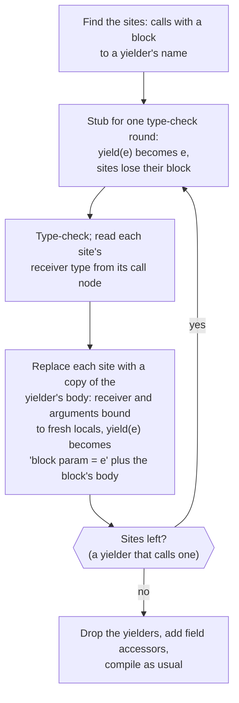

# Spike: inlining `yield` in Sparkle, without a ponyc fork

The question from the roadmap's step 2: does inlining a block into a method that `yield`s need a fork of `ponyc`, or can Sparkle do it, the way it tells fields from methods? **Sparkle can.** The code is [`spike/yield/inline.cr`](../spike/yield/inline.cr), run on [`bag.spk`](../spike/yield/bag.spk) and [`cases.spk`](../spike/yield/cases.spk), on Linux with the unmodified Pony 0.78.2.

```sh
crystal run spike/yield/inline.cr -- spike/yield/cases.spk
```

```text
round 1: each_twice at 44:11 on Box[String val] ref
round 1: each_item at 38:11 on Box[String val] ref
round 1: each_item at 33:11 on Box[String val] ref
round 2: each_item at 44:5 on Box[String val] ref
inlined in 2 rounds
joined abc
until c ab
twice aabbcc
```

## How it works

A method whose body calls `yield(...)` is a *yielder*; the spike spells it as a call so the parser needs no change. Each call with a block to a method of that name is a *site*.



| Case | Result |
|---|---|
| Block assigns to a local of the caller (`total += v`), which a lambda cannot do | Works |
| Generic receiver, `Box(String)` | Works: the type reads `Box[String val] ref`, and the copy is re-typed by ponyc |
| `break` in the block | Works when the yielder's loop is its last statement |
| A yielder that calls another yielder (`each_twice` over `each_item`) | Works, in two rounds |

## What it found

1. **Pony fields are private to their type,** not to the package: inlined code that reads `@items` fails with "can't lookup private fields from outside the type". The spike generates an accessor per field the yielder reads, `def _yf_items : this->Array(A) = @items`, with the yielder's capability. A method whose name starts with `_` is private to the package, so the caller can use it. A yielder in another package, such as a Sparkle standard library, would need public accessors under a reserved name.
2. **Declaration order is checked by source position.** Copied nodes keep their positions by default, so a yielder written above its caller makes the copy's locals look used before they are declared. The spike gives every copied node the call's position, so an error inside a yielder is reported at the call, not in the yielder. Crystal reports both; a later version could add the yielder's line to the message.
3. **The type round must resolve.** An unresolved name (`yield`) stops ponyc before the expression pass, so nothing gets a type. Hence the stub: `yield(e)` becomes `e`, and every call to a yielder drops its block.
4. **ponyc's state is global.** Two sessions cannot be open at once; the spike runs the field-or-method loop and its own type round one after the other. A real version would run both in one session, as one loop.
5. **After the expression pass, a call is `(call (funref receiver name) …)`**, not `(call (. receiver name) …)`, so the receiver is the first child of the call's first child.

## Not done, and what it would take

| Gap | Approach |
|---|---|
| `yield` as a value (`map`, `select`) | A sequence expression in Sparkle's AST: `(x = e; block body)` |
| `next` in a block, when the yielder has statements after its `yield` | Rewrite the block body so `next` skips the rest of it, not the yielder's loop |
| `break` in a block, when the yielder has statements after its loop; `return` in a yielder | A flag local set before breaking out of each enclosing loop, and checked after it |
| Writing a field in a yielder | A generated setter, as for reading |
| Recursion | Refuse a yielder that reaches itself |
| A site whose receiver is not a Sparkle type with that yielder | Lower it as today: a lambda, or loop sugar |
| Calls on `self` inside a class | The type is the enclosing class; no round needed |

The last two rows also make `each` better than today. The by-name loop sugar would stay for Pony's own types only, and a Sparkle type's `each` would be inlined by its type.

## What it means for the plan

No fork is needed for step 2. The roadmap assumed `yield` inlining had to change the type checker mid-pass; it does not, because a type-check round tells Sparkle each receiver's type, and inlining happens in Sparkle's own AST before lowering, as the field-or-method loop does. The cost is one more round per level of yielders calling yielders, each under 0.1 s once the standard library is loaded.

A fork stays the route for anything that must change what the type checker does mid-pass. None is known yet.
