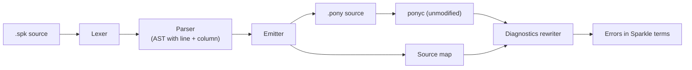

# Step 1 specification: the Sparkle → Pony translator

Step 1 is a source-to-source translator. It parses Sparkle (`.spk`), writes Pony, and runs an unmodified `ponyc` on the result. It has **no type information**: every rule below is decided from syntax alone. Where that forces a compromise, the rule is marked *(typeless)*.



## 1. Lexical rules

- Comments run from `#` to end of line and are dropped.
- A newline ends a statement, except: after a binary operator, a comma, `.`, or an opening `(`/`[`/`{`; inside `(`…`)` and `[`…`]`; and when the next non-blank line starts with `.` (a method chain).
- Identifiers: `[a-z_][A-Za-z0-9_]*`, optionally ending in `?` or `!` when that character follows immediately and is not itself followed by `=` (so `a != b` still lexes as `!=`). Constants: `[A-Z][A-Za-z0-9_]*` (never take a `?`/`!` suffix into the name).
- Instance variables: `@name`.
- Numbers: decimal, `0x`, `0b`, `_` separators, floats. A Crystal suffix (`1_u64`, `2.5_f32`, `7u8`) becomes a Pony conversion (`U64(1)`, `F32(2.5)`).
- Strings: `"…"` with Pony-compatible escapes and `#{expr}` interpolation (nested braces and strings allowed inside). Chars: `'a'`.
- Capability words (`iso trn ref val box tag`, and the generic capability sets `read send share alias any`) are **contextual**: keywords only in type position, right after `def`, right after a type-declaration keyword, and right after `recover`. Everywhere else they are ordinary identifiers. Pony still reserves them, so a variable named `val` is emitted as `val_`.

## 2. Declarations

| Sparkle | Pony |
|---|---|
| `use "collections"` | `use "collections"` |
| `class Foo … end` (also `actor`, `struct`, `primitive`, `trait`, `interface`) | same keyword |
| `class val Point` | `class val Point` |
| `class Box(A)` / `class Box(A : val)` / `class Box(A : val Stringable)` | `class Box[A]` / `class Box[A: Any val]` / `class Box[A: Stringable val]` |
| `include Comparable(Foo)` inside a body (repeatable) | `is Comparable[Foo]` (several: `is (A & B)`) |
| `alias Name = Type` | `type Name is Type` |
| `@n : UInt64 = 0` in a body | `var _n: U64 = 0` |
| `def name(a : A, b : B = 1) : R … end` | `fun name(a: A, b: B = 1): R => …` |
| `def name = expr` (one-liner) | `fun name() => expr` |
| `def ref push(x : A)` | `fun ref push(x: A)` |
| `def self.new(env : Env)` | `new create(env: Env)` |
| `def iso self.new` | `new iso create()` |
| `def self.from_pair(a : A)` | `new from_pair(a: A)` |
| `be name(a : A) … end` (actors) | `be name(a: A) => …` |
| `abstract def name : R` (no body, no `end`) | `fun name(): R` |
| `def first! : A` | `fun first(): A ?` |
| `def empty? : Bool` | `fun is_empty(): Bool` |
| `def name=(v : A)` | `fun ref set_name(v: A)` |
| `def +(o : T) : T` | `fun add(o: T): T` |

Operator method names: `+ add`, `- sub`, `* mul`, `/ div`, `% rem`, `== eq`, `!= ne`, `< lt`, `<= le`, `> gt`, `>= ge`, `<< push`, `>> shr`, `[] apply`, `[]! apply … ?`, `[]= update`.

A field needs a type (`@n = 0` alone is a parse error). `def []=`, `def <<` and `def name=` default to `fun ref` when no capability is written.

Pony requires fields before methods, so the emitter writes all of a type's fields first, then methods in source order. An empty body emits `None`.

A `class` or `struct` with no `def self.new` and every field initialised gets an explicit `new create() => None`. Without it Pony infers an `iso` constructor, and `x = Foo.new` could not be passed as a `ref`.

Instance variables map to **private** Pony fields (`@n` → `_n`). This gives Crystal's rule that fields are private, and lets a field and a method share a name (`@count` and `def count`), which Pony otherwise forbids.

## 3. Types

| Sparkle | Pony |
|---|---|
| `Int8 … Int128`, `UInt8 … UInt128` | `I8 … I128`, `U8 … U128` |
| `Float32`, `Float64` | `F32`, `F64` |
| `Nil` | `None` |
| `Array(String)` | `Array[String]` |
| `val String` | `String val` |
| `iso^ String` (ephemeral), `A!` (alias) | `String iso^`, `A!` |
| `String?` / `val String?` | `(String \| None)` / `(String val \| None)` |
| `A \| B`, `A & B` | `(A \| B)`, `(A & B)` |
| `{A, B}` | `(A, B)` |
| `this->A`, `box->A` | `this->A`, `box->A` |
| `Proc(A, B)` (last is the return type) / `val Proc(A, B)` | `{(A): B}` / `{(A): B} val` |
| a capability alone, e.g. `(A : val)` or `(A : send)` | `Any val`, `Any #send` |

All other type names pass through unchanged, so every Pony stdlib type is usable.

## 4. Expressions and statements

### Names, fields and calls

| Sparkle | Pony | Note |
|---|---|---|
| `x = 1` (first assignment in scope) | `var x = 1` | later assignments emit `x = 2` |
| `x : UInt8 = 1` | `var x: U8 = 1` | |
| `x = 0` / `x = 1.5` (first assignment, bare literal) | `var x: I32 = 0` / `var x: F64 = 1.5` | Crystal's literal defaults; Pony cannot infer them |
| a parameter or local named like a method of its type | emitted with a prime: `payload'` | Pony forbids the clash; Crystal's `def self.new(payload)` beside `def payload` is idiomatic |
| `@n` | `_n` | |
| `self` | `this` | |
| `x.size` | `x.size()` | *(typeless)* a dot-name is **always a call** |
| `x.@name` | `x._name` if `name` is an ivar of the enclosing type, otherwise `x.name` | explicit field read; the second form reads a public field of a Pony type (`env.@out`) |
| `foo` (not a local or parameter) | `foo()` | call on `this` |
| `Foo.new(a)` / `Array(String).new` | `Foo.create(a)` / `Array[String].create()` | |
| `f(x: 1)` | `f(where x = 1)` | named arguments |
| `a[i]` / `a[i]!` | `a(i)` / `a(i)?` | |
| `a[i] = v` / `a[i]! = v` | `a(i) = v` / `a(i)? = v` | |
| `x.name = v` | `x.set_name(v)` | |
| `x.first!` / `x.parse!(s)` | `x.first()?` / `x.parse(s)?` | `!` is Pony's partial-call `?` |
| `x.empty?` | `x.is_empty()` | |
| `x.as!(T)` | `(x as T)` | |
| `x.nil?` | `(x is None)` | |

### Operators

Pony has no operator precedence, so the emitter parenthesises every nested binary expression using Crystal's precedence.

| Sparkle | Pony |
|---|---|
| `&&`, `\|\|`, `!x` | `and`, `or`, `not x` |
| `+ - * / % == != < <= > >=`, `>>`, `is`, `isnt` | unchanged |
| `a << b` | `a.push(b)` *(typeless: integer shift is `a.shl(b)`)* |
| `a += b` (also `-= *= /= %=`) | `a = a + b` |
| `c ? a : b` | `if c then a else b end` |
| `a...b` / `a..b` | `Range[USize].till(a, b)` / `Range[USize].through(a, b)`, adding `use "collections"` if missing *(typeless: the element type is fixed at `USize`)* |

### Literals

| Sparkle | Pony |
|---|---|
| `nil`, `true`, `false` | `None`, `true`, `false` |
| `"n = #{n}!"` / `"#{n}"` | `"n = " + n.string() + "!"` / `"" + n.string()` |
| `[1, 2, 3]` / `[1, 2] of UInt8` / `[] of String` | `[1; 2; 3]` / `[as U8: 1; 2]` / `Array[String].create()` |
| `{a, b}` in expression position | `(a, b)` |

### Control flow

| Sparkle | Pony |
|---|---|
| `if c … elsif d … else … end` | `if c then … elseif d then … else … end` |
| `unless c … end` | `if not (c) then … end` |
| `stmt if c` / `stmt unless c` | `if c then stmt end` / `if not (c) then stmt end` |
| `while c … end` / `until c … end` | `while c do … end` / `while not (c) do … end` |
| `loop do … end` | `while true do … end` |
| `break`, `next`, `return x` | `break`, `continue`, `return x` |
| `case x when 1, 2 … when s : String … when {a, b} … else … end` | `match x \| 1 \| 2 => … \| let s: String => … \| (a, b) => … else … end` |
| `case x in …` | `match \exhaustive\ x …` |
| `begin … rescue … ensure … end` | `try … else … then … end` |
| `raise` (takes no value) | `error` |
| `consume x` | `consume x` |
| `recover iso do … end` / `recover do … end` | `recover iso … end` / `recover … end` |

### Blocks

Step 1 has no `yield`. A block is either loop sugar or a lambda.

| Sparkle | Pony | Note |
|---|---|---|
| `xs.each do \|x\| … end` | `for x in xs.values() do … end` | *(typeless, by method name)* |
| `xs.each_with_index do \|x, i\| … end` | `for (i, x) in xs.pairs() do … end` | |
| `n.times do \|i\| … end` | `for i in Range[USize].till(0, n) do … end` | `n` must be a `USize` |
| `(a...b).each do \|i\| … end` | `for i in Range[USize].till(a, b) do … end` | |
| any other `recv.m(args) do \|x\| … end` or `{ \|x\| … }` | `recv.m(args, {(x) => …})` | lambda as last argument |
| `&.name` as an argument | `{(x) => x.name()}` | |

`break` and `next` work inside loop sugar because it is a real Pony loop.

## 5. Tooling

1. **Source map.** The emitter records a mark `(pony line, pony column) → (sparkle line, sparkle column)` each time it starts writing a node. A `ponyc` location maps to the last mark at or before it on that line.
2. **Diagnostics.** `ponyc` output is rewritten: file, line and column go through the source map, the quoted source excerpt is replaced by the Sparkle line with a caret, and Pony type expressions inside messages are re-printed in Sparkle syntax, including in notes that point into the Pony stdlib (`Array[String val] ref` → `ref Array(val String)`, `(String val | None val)` → `val String?`).
3. **Capability statistics.** `sparkle caps` reports, per file, how many capability annotations were written, by position (type declaration, `def`, type, `recover`) and by capability.

## 6. CLI

```
sparkle translate FILE.spk          # print the generated Pony
sparkle build PATH [-o DIR]         # PATH is a .spk file or a directory (one Pony package)
sparkle run PATH [-- args]          # build, then run the binary
sparkle caps PATH...                # capability statistics
```

`build` writes generated Pony under `.sparkle/<package>/` and runs `ponyc` on it. `ponyc` is found via `$SPARKLE_PONYC`, then `.tools/ponyc/bin/ponyc` (installed by `make ponyc`), then `vendor/ponyc/build/release/ponyc` (built by `make ponyc-source`), then `PATH`. Both paths are searched upward from the executable's directory and from the current directory.

## 7. Not in step 1

`yield`, macros (`getter`, `property`, `record`), `enum`, calls with arguments but no parentheses (`puts "x"`), hash and symbol literals, FFI, `let`/`embed` fields, generic method calls, reopening types.

## 8. Known semantic gaps

- Pony assignment evaluates to the **old** value of the left side, not the new one.
- A variable first assigned inside a branch or loop is scoped to that block, as in Pony.
- `ticks = 0` is an `Int32`, as in Crystal, so it will not compare with a `USize`. Write `ticks : USize = 0`.
- A named argument is not primed, because the callee is unknown: `f(payload: 1)` fails when `f`'s type also has a method `payload`.
- `x.@name` picks the private field whenever the enclosing type has an ivar of that name, so a type with `@out` cannot also read `env.@out`.
- In a `case`, a tuple pattern `{a, b}` compares against existing values; binding is written `{a : String, b : UInt32}`.
- A continuation line inside parentheses may not start with an operator; end the previous line with it instead.
- `def pop` and `def pop!` both become `pop`; `def empty?` and `def is_empty` both become `is_empty`. Defining both is an error from `ponyc`.
