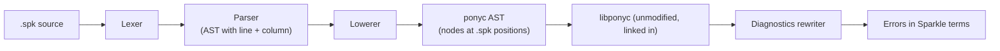
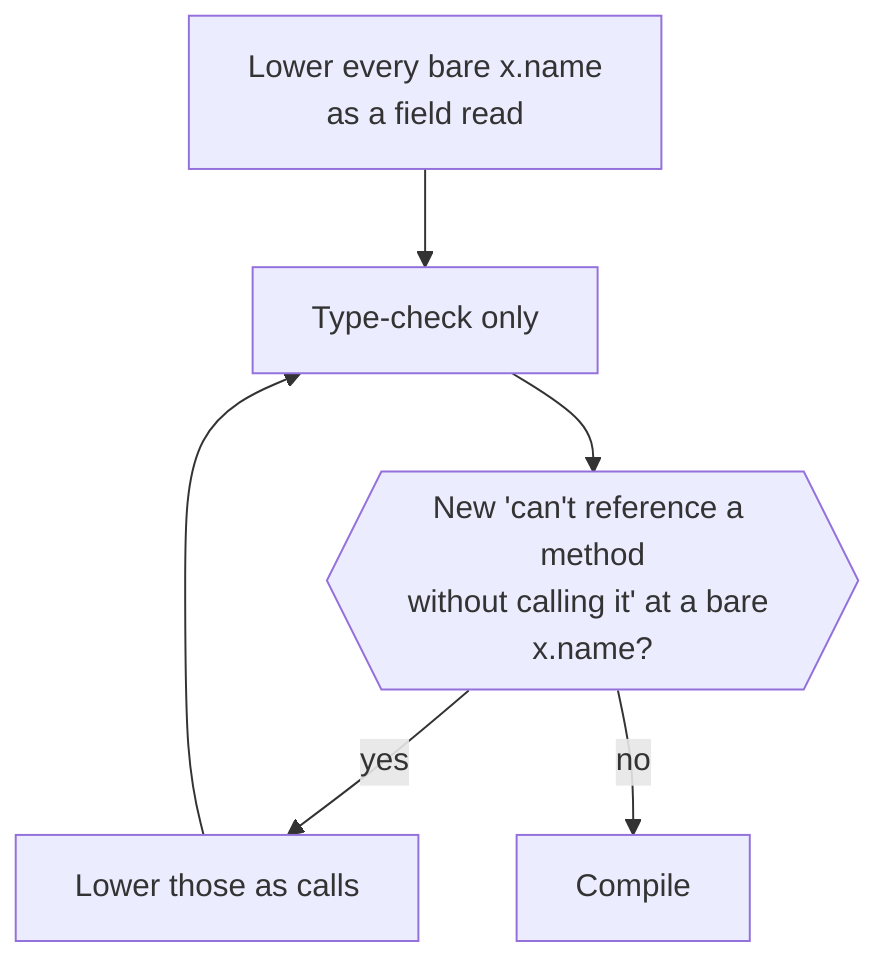

# Step 1 specification: the Sparkle → Pony translator

Step 1 is a front end for an unmodified `ponyc`. It parses Sparkle (`.spk`), lowers it to the AST `ponyc`'s parser would build from the equivalent Pony, and compiles that in-process. Each rule below is written as Sparkle beside that equivalent Pony; the rule specs (`spec/rules_spec.cr`) check that the lowered tree equals `ponyc`'s parse of it. The translator has **no type information**: every rule is decided from syntax alone, except whether a bare `x.name` is a field or a method, which the compiler settles. Where that forces a compromise, the rule is marked *(typeless)*.



## 1. Lexical rules

- Comments run from `#` to end of line and are dropped.
- A newline ends a statement, except: after a binary operator, a comma, `.`, or an opening `(`/`[`/`{`; inside `(`…`)` and `[`…`]`; and when the next non-blank line starts with `.` (a method chain).
- Identifiers: `[a-z_][A-Za-z0-9_]*`, optionally ending in `?` or `!` when that character follows immediately and is not itself followed by `=` (so `a != b` still lexes as `!=`). Constants: `[A-Z][A-Za-z0-9_]*` (never take a `?`/`!` suffix into the name).
- Instance variables: `@name`.
- Numbers: decimal, `0x`, `0b`, `_` separators, floats. A Crystal suffix (`1_u64`, `2.5_f32`, `7u8`) becomes a Pony conversion (`U64(1)`, `F32(2.5)`).
- Strings: `"…"` with Pony-compatible escapes and `#{expr}` interpolation (nested braces and strings allowed inside). Chars: `'a'`.
- Capability words (`iso trn ref val box tag`, and the generic capability sets `read send share alias any`) are **contextual**: keywords only in type position, right after `def`, right after a type-declaration keyword, and right after `recover`. Everywhere else they are ordinary identifiers. Pony still reserves them, so a variable named `val` becomes `val_`.

## 2. Declarations

| Sparkle | Pony |
|---|---|
| `require "collections"` | `use "collections"` |
| `class Foo … end` (also `actor`, `struct`, `primitive`, `trait`, `interface`) | same keyword |
| `class val Point` | `class val Point` |
| `class Box(A)` / `class Box(A : val)` / `class Box(A : val Stringable)` | `class Box[A]` / `class Box[A: Any val]` / `class Box[A: Stringable val]` |
| `include Comparable(Foo)` inside a body (repeatable) | `is Comparable[Foo]` (several: `is (A & B)`) |
| `alias Name = Type` | `type Name is Type` |
| `@n : UInt64 = 0` in a body | `var _n: U64 = 0` |
| `def name(a : A, b : B = 1) : R … end` | `fun name(a: A, b: B = 1): R => …` |
| `def name = expr` (one-liner) | `fun name() => expr` |
| `def ref push(x : A)` | `fun ref push(x: A)` |
| `def self.new(env : Env)` | `new create(env: Env)` |
| `def iso self.new` | `new iso create()` |
| `def self.from_pair(a : A)` | `new from_pair(a: A)` |
| `on name(a : A) … end` (actors) | `be name(a: A) => …` |
| `abstract def name : R` (no body, no `end`) | `fun name(): R` |
| `def first! : A` | `fun first(): A ?` |
| `def empty? : Bool` | `fun is_empty(): Bool` |
| `def name=(v : A)` | `fun ref set_name(v: A)` |
| `def +(o : T) : T` | `fun add(o: T): T` |

### Enums

```crystal
enum Colour
  Red
  Green = 5
  Blue
end
```

becomes one `primitive` per member, named after the enum, and a union type:

```pony
primitive ColourRed
  fun value(): I32 => 0
  fun string(): String iso^ => "Red".clone()
  fun eq(that: Colour): Bool => that is this
  fun ne(that: Colour): Bool => not (that is this)
  fun is_red(): Bool => true
  fun is_green(): Bool => false
  fun is_blue(): Bool => false

primitive ColourGreen
  …                                  // value 5

primitive ColourBlue
  …                                  // value 6

type Colour is (ColourRed | ColourGreen | ColourBlue)
```

- A member is a constant on its own line, optionally `= n` with an integer literal (which may be negative). Values start at 0 and each unvalued member is one more than the previous. `value` is always `Int32`.
- `string` gives the member's name, so `"#{c}"` prints `Green` and a member is `Stringable`. `eq` and `ne` make `==` and `!=` work.
- Each member has a **predicate per member of its enum**, as in Crystal: `c.green?` is true only for `Colour::Green`. The predicate's name is the member's in snake case (`DarkGreen` gives `dark_green?`), and like every `?` method it becomes `is_…` in Pony.
- An enum needs at least one member, and member names must be distinct. Methods, flags (`@[Flags]`) and a base type (`enum Colour : UInt8`) are not supported: anything but a member in the body is a parse error.

Operator method names: `+ add`, `- sub`, `* mul`, `/ div`, `% rem`, `== eq`, `!= ne`, `< lt`, `<= le`, `> gt`, `>= ge`, `<< push`, `>> shr`, `[] apply`, `[]! apply … ?`, `[]= update`.

A field needs a type (`@n = 0` alone is a parse error). `def []=`, `def <<` and `def name=` default to `fun ref` when no capability is written.

Pony requires fields before methods, so a type's fields come first, then its methods in source order. An empty body is `None`.

A `class` or `struct` with no `def self.new` and every field initialised gets an explicit `new create() => None`. Without it Pony infers an `iso` constructor, and `x = Foo.new` could not be passed as a `ref`.

Instance variables map to **private** Pony fields (`@n` → `_n`). This gives Crystal's rule that fields are private, and lets a field and a method share a name (`@count` and `def count`), which Pony otherwise forbids.

### Packages

A package is a directory of `.spk` files. `require` names one, at the top of a file:

| Sparkle | Meaning |
|---|---|
| `require "./geometry"`, `require "../shared"` | the Sparkle package in that directory, relative to the file's own |
| `require "json"` | the Sparkle library's package `json` if it has one, else Pony's package `json` |
| `use "collections"` | an error: "`use` is written `require` in Sparkle" |

- **Building.** `sparkle build app` parses `app`, then each Sparkle package it requires, and theirs, depth first. Each becomes an in-memory Pony package registered under a key, `spk_<directory name>` (numbered if two directories share a name), and the lowered `use` names that key. The packages are type-checked together, in one compiler session, and compiled into one binary.
- **Scope.** Every public name of a required package comes into scope; there are no qualified names yet. A name starting with `_` is private to its package, and a field to its type, as in Pony.
- **Errors.** A relative path with no `.spk` files is an error at the `require`, and so is a cycle, which is named. Errors inside a required package are reported at its own files.
- **The library** is the directory named by `$SPARKLE_LIB`, else `share/sparkle/stdlib` beside an installed `bin/sparkle`, else `stdlib/` found upward from the executable or the working directory. Its package `prelude`, if present, is required by every package outside the prelude's own requirements, without a `require`.
- **Reserved names.** An identifier starting with `spk_`, a local, method, field or parameter, is an error: Sparkle generates such names (`spk_view`, `spk_r1`, `spk_yf_items`).

## 3. Types

| Sparkle | Pony |
|---|---|
| `Int8 … Int128`, `UInt8 … UInt128` | `I8 … I128`, `U8 … U128` |
| `Float32`, `Float64` | `F32`, `F64` |
| `Nil` | `None` |
| `Array(String)` | `Array[String]` |
| `val String` | `String val` |
| `iso^ String` (ephemeral), `A!` (alias) | `String iso^`, `A!` |
| `String?` / `val String?` | `(String \| None)` / `(String val \| None)` |
| `A \| B`, `A & B` | `(A \| B)`, `(A & B)` |
| `{A, B}` | `(A, B)` |
| `this->A`, `box->A` | `this->A`, `box->A` |
| `Proc(A, B)` (last is the return type) / `val Proc(A, B)` | `{(A): B}` / `{(A): B} val` |
| a capability alone, e.g. `(A : val)` or `(A : send)` | `Any val`, `Any #send` |

All other type names pass through unchanged, so every Pony stdlib type is usable.

## 4. Expressions and statements

### Names, fields and calls

| Sparkle | Pony | Note |
|---|---|---|
| `x = 1` (first assignment in scope) | `var x = 1` | later assignments become `x = 2` |
| `x : UInt8 = 1` | `var x: U8 = 1` | |
| `x = (y = 5)`, `x = y = 5` | `var x = (var y: I32 = 5; y)` | an assignment used as a value gives the **new** value, as in Crystal; see below |
| `x = 0` / `x = 1.5` (first assignment, bare literal) | `var x: I32 = 0` / `var x: F64 = 1.5` | Crystal's literal defaults; Pony cannot infer them. See *Literal defaults* below |
| a parameter or local named like a method of its type | given a prime: `payload'` | Pony forbids the clash; Crystal's `def self.new(payload)` beside `def payload` is idiomatic |
| `@n` | `_n` | |
| `self` | `this` | |
| `Colour::Green` | `ColourGreen` | an enum member; not checked against the enum *(typeless)*, so `ponyc` reports an unknown one |
| `x.size` (no arguments, parentheses or block) | `x.size` or `x.size()` | a **field read unless the type checker says `size` is a method**; `sparkle build` decides, see *Fields and methods* below |
| `x.@name` | `x._name` if `name` is an ivar of the enclosing type, otherwise `x.name` | explicit field read, never a call |
| `foo` (not a local or parameter) | `foo()` | call on `this` |
| `Foo.new(a)` / `Array(String).new` | `Foo.create(a)` / `Array[String].create()` | |
| `f(x: 1)` | `f(where x = 1)` | named arguments |
| `Message.new(payload: s)`, where some `def self.new(payload …)` in the package has its `payload` primed | `Message.create(where payload' = s)` | a named argument is primed when a Sparkle method of the same Pony name, anywhere in the package, primes that parameter *(typeless: matched by method name, not by receiver type)* |
| `a[i]` / `a[i]!` | `a(i)` / `a(i)?` | |
| `a[i] = v` / `a[i]! = v` | `a(i) = v` / `a(i)? = v` | |
| `x.name = v` | `x.set_name(v)` | |
| `x.first!` / `x.parse!(s)` | `x.first()?` / `x.parse(s)?` | `!` is Pony's partial-call `?` |
| `x.empty?` | `x.is_empty()` | |
| `x.as!(T)` | `(x as T)` | |
| `x.nil?` | `(x is None)` |
| `counter <~ add(3)` / `self <~ tick` | `counter.add(3)` / `this.tick()` | posts a message; see *Messages* below | |

### Messages

A caller **calls a method** and waits for its reply, or **posts a message** and goes on at once, trusting the actor's handler to process it and expecting nothing back. `on` declares a message handler; `<~` posts the message. Both lower to Pony's behaviour (`be`) and an ordinary call.

```crystal
actor Counter
  @count : Int32 = 0

  on add(n : Int32)
    @count += n
    self <~ report
  end

  on report
  end
end

counter <~ add(3)
env.out <~ print("added")
```

- **Required both ways.** A message, the standard library's included (`env.out <~ print(s)`), must be posted with `<~`, and `<~` must reach a message handler. Either mistake is an error at the call: "`add` is a message: post it with `<~`", or "`<~` posts a message, and `size` is a method: call it with `.`".
- **A target is required.** A message to the actor itself is posted with `self <~ name`; there is no bare form. It is handled after the current message, not in place.
- **The right side** is a method name with its arguments, in parentheses or none; a block is not allowed. `<~` binds like `.`, so `a.b <~ c(1)` posts `c` to `a.b`.
- **How it is checked** *(typeless)*: after ponyc's expression pass, a call whose callee is a behaviour reference (`beref`) reaches a message handler. The type-checking rounds that tell fields from methods record them; after the last round, each is compared with the calls written with `<~`.
- **Lexing.** `<~` is one token, so Crystal's `a <~b`, meaning `a < ~b`, must be written with a space.
- `be` is not Sparkle: it is an error that says to write `on`.

### Order of evaluation

Sparkle evaluates left to right, as Crystal does: a receiver, then its arguments in order. Pony evaluates a method call's arguments first and its receiver last (only operators on numbers, which it compiles inline, go left to right), so the lowering binds the receiver first when the order could show:

| Sparkle | Pony |
|---|---|
| `log.add("a").add(log.word("b"))` | `(let spk_r1 = log.add("a"); (consume spk_r1).add(log.word("b")))` |
| `make() + make()` | `(let spk_r2 = make(); (consume spk_r2) + make())` |
| `log.add(log.word("b"))` | unchanged: a local receiver cannot change |

- **When.** The receiver is bound when it may change, and some argument may have an effect. It may change unless it is a literal, `self`, a type, an enum member, a local, a field (see *Known semantic gaps*) or a bare `x.name` that the type checker found to be a field. An argument may have an effect if it holds a call, an index, an assignment, a `yield` or a `raise`; a block's body runs later, so a block has none.
- **Which calls.** Method calls, indexing, operators (`+`, `==`, … on any type; `&&` and `||` are always left to right), `<<`, setters and index assignment. String interpolation has its own lowering (see *Literals*).
- **Types.** `consume` gives the bound value back with the type the receiver had, so an `iso` result stays `iso^`. The `let` costs nothing after optimisation.

### Fields and methods

In Crystal `x.name` with no parentheses is a method call, but Pony types also have public fields, such as `env.out`. A bare `x.name` is therefore a field read when `x`'s type has a field `name`, and a call otherwise. The translator has no types, so `sparkle build` asks the compiler:



| Sparkle | Pony that is compiled | Rounds of type checking |
|---|---|---|
| `env.out <~ print("hi")` | `env.out.print("hi")` | 1 |
| `xs.size` | `xs.size()` | 2 |
| `env.args.size.string` | `env.args.size().string()` | 3 |

- **Bare** means a call with a receiver, no arguments, no parentheses and no block, whose name does not end in `!` or `?`, and which is not an assignment target. A receiver that is a type (`Foo.new`, `Array(String).new`, `Foo.bar`) is always a call, because Pony types have no fields.
- A position is reported against the Sparkle name after the dot, so one round settles every bare name whose receiver's type is known; a chain settles one link per round.
- The default is a field because the reverse cannot work: calling a field means calling `apply()` on its value, which either fails with an unrelated error or compiles with a different meaning.
- `x.@name` still reads a field and is never a call. `env.@out` keeps working; `env.out` is the ordinary spelling.
- `sparkle translate` prints the lowered tree, after the type checker settled which bare `x.name`s are calls. The examples' `expected.ast` files hold that tree.

### Assignment as a value

Pony's assignment evaluates to the old value; Sparkle's, like Crystal's, to the new one. An assignment is a **statement** when its value is discarded: a statement that is not the last of its block, the last of a block whose value is unused (a loop body, a block passed as a lambda, a `be`, a constructor, a method with no return type or `Nil`, an `if` used as a statement), or the body of a modifier `if`/`unless` used as a statement. A statement is lowered as written. Anywhere else the assignment is a **value**, and the target is read back:

| Sparkle | Pony |
|---|---|
| `y = 5` (statement) | `y = 5` |
| `x = (y = 5)` | `var x = (y = 5; y)` |
| `def ref incr : UInt64 = @n += 1` | `fun ref incr(): U64 => (_n = _n + 1; _n)` |
| `while (n -= 1) > 0` | `while (n = n - 1; n) > 0 do` |

Only a local or `@field` target can be used as a value. An index (`a[i] = v`), setter (`x.name = v`) or field write (`x.@name = v`) used as a value is a translation error.

### Operators

Pony has no operator precedence, so every nested binary expression is grouped, as if parenthesised, using Crystal's precedence.

| Sparkle | Pony |
|---|---|
| `&&`, `\|\|`, `!x` | `and`, `or`, `not x` |
| `+ - * / % == != < <= > >=`, `>>`, `is`, `isnt` | unchanged |
| `a << b` | `a.push(b)` *(typeless: integer shift is `a.shl(b)`)* |
| `a += b` (also `-= *= /= %=`) | `a = a + b` |
| `c ? a : b` | `if c then a else b end` |
| `a...b` / `a..b` | `Range[USize].till(a, b)` / `Range[USize].through(a, b)`, adding `use "collections"` if missing *(typeless: the element type is fixed at `USize`)* |

### Literals

| Sparkle | Pony |
|---|---|
| `nil`, `true`, `false` | `None`, `true`, `false` |
| `"n = #{n}!"` / `"#{n}"` | `"n = " + n.string() + "!"` / `"" + n.string()` |
| `"#{a.f} and #{b}"` | `(let spk_s1_4: String val = a.f().string(); spk_s1_4 + " and " + b.string())` |
| `[1, 2, 3]` / `[1, 2] of UInt8` / `[] of String` | `[1; 2; 3]` / `[as U8: 1; 2]` / `Array[String].create()` |
| `{a, b}` in expression position | `(a, b)` |

Parts of an interpolated string run left to right, as in Crystal. Pony evaluates a method call's argument before its receiver, and `String`'s `+` is a method, so a plain chain of `+` would run them from the right. With two or more expression parts, each but the last is first bound to a `let`, named for its line and column.

#### Literal defaults

Pony gives a numeric literal its type from where it is used, and fails with "could not infer literal type" where nothing does. Sparkle gives it Crystal's type there instead: `Float64` if it has a float literal, `Int32` otherwise. *(typeless: decided by position, not by types)*

A **literal expression** is an unsuffixed number, or one built from such numbers with `+ - * / %`, unary `-`, parentheses and `c ? a : b`, or an array literal of them without `of` (not of arrays).

| Position | Sparkle | Pony |
|---|---|---|
| first untyped assignment | `x = c ? 1 : -2` / `a = [1, 2]` / `f = [1, 2.5]` | `var x: I32 = if c then 1 else -2 end` / `var a: Array[I32] = [1; 2]` / `var f: Array[F64] = [1; 2.5]` |
| first untyped assignment of a tuple of literal expressions, strings and booleans | `t = {1, "a", true}` | `var t: (I32, String, Bool) = (1, "a", true)` |
| receiver of a call, field read or index | `7.string` / `-1.abs` / `[1, 2].size` | `I32(7).string()` / `I32(-1).abs()` / `[as I32: 1; 2].size()` |
| interpolated | `"#{1 + 2}"` | `(I32(1) + I32(2)).string()` |

Everywhere else (arguments, typed assignments, return values, operands) Pony infers the type from context, so `f(1)` passes a `UInt8` to `f(x : UInt8)`, and `n + 1` has `n`'s type. A ternary's condition keeps its own types. A char literal (`'a'`) gets no default: write `c : UInt8 = 'a'`.

### Control flow

| Sparkle | Pony |
|---|---|
| `if c … elsif d … else … end` | `if c then … elseif d then … else … end` |
| `unless c … end` | `if not (c) then … end` |
| `stmt if c` / `stmt unless c` | `if c then stmt end` / `if not (c) then stmt end` |
| `while c … end` / `until c … end` | `while c do … end` / `while not (c) do … end` |
| `loop do … end` | `while true do … end` |
| `break`, `next`, `return x` | `break`, `continue`, `return x` |
| `case x when 1, 2 … when s : String … when {a, b} … else … end` | `match x \| 1 \| 2 => … \| let s: String => … \| (a, b) => … else … end` |
| `case x in …` | `match \exhaustive\ x …` |
| `when Colour::Red` / `in Colour::Red` | `\| let _: ColourRed =>` | matched by type, because Pony does not count a primitive with its own `eq` towards exhaustiveness |
| `when .red?` | `\| let _: ColourRed =>` | an enum predicate as a pattern, as Crystal writes it. It names the one member of an enum in the package whose predicate is `red?`, so an exhaustive `case … in` stays exhaustive. It is an error when no enum, or more than one, has such a member (write `when Colour::Red`), and for any other `when .name` |
| `begin … rescue … ensure … end` | `try … else … then … end` |
| `raise` (takes no value) | `error` |
| `consume x` | `consume x` |
| `recover iso do … end` / `recover do … end` | `recover iso … end` / `recover … end` |

### Blocks

Step 1 has no `yield`. A block is either loop sugar or a lambda.

| Sparkle | Pony | Note |
|---|---|---|
| `xs.each do \|x\| … end` | `for x in xs.values() do … end` | *(typeless, by method name)* |
| `xs.each_with_index do \|x, i\| … end` | `for (i, x) in xs.pairs() do … end` | |
| `n.times do \|i\| … end` | `for i in Range[USize].till(0, n) do … end` | `n` must be a `USize` |
| `(a...b).each do \|i\| … end` | `for i in Range[USize].till(a, b) do … end` | |
| any other `recv.m(args) do \|x\| … end` or `{ \|x\| … }` | `recv.m(args, {(x) => …})` | lambda as last argument |
| `&.name` as an argument | `{(x) => x.name()}` | |

`break` and `next` work inside loop sugar because it is a real Pony loop.

### `yield` (step 2)

A method whose body contains `yield` is a **yielding method**. It is not compiled by itself. Each call to it with a block is replaced by a copy of its body, in which `yield a, b` runs the block with its parameters bound to `a` and `b`. The block runs in the caller, so it can assign the caller's locals, which a lambda cannot.

```crystal
class Bag
  @items : Array(UInt32)

  def each_item
    @items.each do |x|
      yield x
    end
  end
end

total : UInt32 = 0
bag.each_item do |v|
  total += v
end
```

becomes, in place of the call:

```pony
var y1_self = bag
for y1_x in y1_self.spk_yf_items().values() do
  var v = y1_x
  total = total + v
end
```

- **Which method.** The receiver's type decides, read from a type-checking round as for fields and methods (see *Fields and methods*). A call with no receiver inside a type is that type's. A call whose receiver's type has no yielding method of that name is lowered as before, as loop sugar or a lambda, so `xs.each do … end` on an `Array` is still a `for` loop.
- **Names.** The copy's receiver, parameters and locals get a fresh prefix (`y1_`), so they cannot clash with the caller's. Error messages print them without it.
- **Fields.** Pony fields are private to their type, so the copy reads `@items` through a generated method `spk_yf_items`, with the yielding method's capability and the return type `this->` the field's type. It is public, so that a copy in another package can call it; the `spk_` prefix keeps it out of Sparkle code.
- **Errors** inside the copy are reported at the yielding method's line, with a note giving the call.
- **Nesting.** A yielding method may call another with a block. Each level is one more type-checking round. A yielding method that reaches itself is an error.
- **Arguments.** `yield` takes values as a call does, with or without parentheses. A block may name fewer parameters than `yield` passes; the rest are ignored. Naming more is an error.
- **Values.** `yield a` used as a value is the block's last statement, so `total += yield x` sums what the block gives. A call whose value is used becomes a sequence expression whose last statement is the method's.
- **Jumps.** In the block, outside a loop of its own:
  - `next` ends this run of the block; each run is a `repeat … until true`, whose `continue` leaves it.
  - `break` leaves the whole call, skipping the rest of the method, as in Crystal: a flag local is set, the run ends, and each loop of the copy that holds the `yield` breaks when it is set, while the statements after it are skipped.
  - `return` returns from the method around the call, since the block runs there.
  
  In the yielding method, a bare `return` leaves the call, by the same flag.
- **Not yet**, each an error that says so: `return` with a value in a yielding method; `next` or `break` in a block whose call's value is used, or whose `yield` value is used; and `return` in a yielding method whose call's value is used.

### Inline-only methods on Pony's types (step 4)

A Sparkle `class` named after a Pony type **reopens** it, and a `module` holds methods for types to `include`. Their methods are **inline-only**: every call, with or without a block, is replaced by a copy of the method's body, as for a yielding method, and nothing of them is compiled. This is how the library's `prelude` gives Pony's `Array` Crystal's `map`, `select` and `sum` (see [enumerable-design.md](enumerable-design.md)).

```crystal
module Enumerable(A)
  def map(&block : A -> B) : Array(B) forall B
    result = [] of B
    each do |x|
      result << yield x
    end
    result
  end

  def sum : A
    total : A = 0
    each do |x|
      total += x
    end
    total
  end
end

class Array(A)
  include Enumerable(A)
end
```

`xs.map { |x| x * 2 }`, for an `xs` of type `Array[U32]`, becomes:

```pony
var y1_self = xs
var y1_result = Array[U32].create()
for y1_x in y1_self.values() do
  y1_result.push((var x = y1_x; x * 2))
end
y1_result
```

- **Which types reopen.** A `class` whose name is a type of Pony's `builtin` or `collections` package, or of a Pony package the file requires, reopens that type. It may hold methods and `include`s only: a field, a constructor or a `maintains` is an error, so a reopened type gains no state and its own rules still hold. Reopening a Sparkle type is not supported.
- **Modules.** `module Name(A)` holds inline-only methods. `include Name(T)` in a reopening gives the type those methods, with the module's `A` read as `T`.
- **Calls.** A call to the name of an inline-only method is a site, with or without a block. As for yielding methods, the receiver's type decides: `Array[U32 val] ref` names `Array`. A receiver whose type has no such method is lowered as before, so a Sparkle class's own `count` is unaffected. A site whose receiver's type is not known yet waits for a later round.
- **Clashing names.** The reopening's method wins over Pony's method of the same name: `xs.find { … }` is Crystal's `find`.
- **Type parameters.** In the copy, the type's parameters are the receiver's type arguments: `A` is `U32` above, so `[] of A` is `Array[U32]` and `total : A = 0` is `var total: U32 = 0`.
- **The block's type.** `&block : A -> B` declares the block's parameter types and its value's type; `&block : A, USize -> B` takes two. `forall B` after the return type names a type that each call fixes. For a site whose method has `forall` names, one more type-check round lowers the site as a loop over an empty array of the block's parameter types, binding the block's value to a local `spk_probe_<n>`; the local's type, read after ponyc's expression pass, is `B`. The loop is only type-checked, never run.
- **`self`** in an inline-only method is the receiver, and a bare call such as `each` is a call on it. `each` on a Pony type is loop sugar, so the copies iterate with Pony's `values()`.

### Contracts (step 3)

A method states what it `expects` of its caller and what it `guarantees` in return; a type states what it `maintains`. Each clause is checked at run time, and a failure prints the clause and its place, then exits with status 1. The design and its reasons are in [contracts-design.md](contracts-design.md).

```crystal
class Account
  maintains @balance >= 0

  @balance : Int64 = 0

  def ref withdraw(amount : Int64) : Int64
    expects amount > 0, amount <= @balance
    guarantees @balance == old(@balance) - amount, result == amount

    @balance -= amount
    amount
  end
end
```

becomes a wrapper with the method's name around the body, renamed `_spk_withdraw`, plus one method that checks the invariant:

```pony
fun ref withdraw(amount: I64): I64 =>
  var spk_view: Account box = this
  var spk_arg_amount: box->I64 = amount
  if not (spk_arg_amount > 0) then _SpkContract.fail("main.spk:8:13: contract failed in Account.withdraw: expects amount > 0") end
  if not (spk_arg_amount <= spk_view._balance) then _SpkContract.fail("…") end
  var spk_old_1 = spk_view._balance
  _SpkContract.keep(spk_old_1)
  var spk_result = _spk_withdraw(amount)
  var spk_result_view: box->I64 = spk_result
  if not (spk_view._balance == (spk_old_1 - spk_arg_amount)) then _SpkContract.fail("…") end
  if not (spk_result_view == spk_arg_amount) then _SpkContract.fail("…") end
  _spk_maintains("Account.withdraw")
  consume spk_result

fun ref _spk_withdraw(amount: I64): I64 => …

fun box _spk_maintains(spk_after: String) =>
  if not (_balance >= 0) then _SpkContract.fail("main.spk:2:13: contract failed after " + spk_after + ": maintains @balance >= 0") end
```

- **Placement.** `expects` and then `guarantees` lines open a `def` or `on`, before its body; `maintains` lines open a type, before its fields and methods. A clause anywhere else is an error. A one-line `def x = expr` takes no clauses. The three words are reserved.
- **Conditions.** A clause holds one or more conditions, separated by commas; each is checked, and reported, on its own. Each is a `Bool` expression.
- **Read-only.** Conditions in the wrapper see `self` through `spk_view`, a `box` alias, and each argument through a `box->` alias, so calling a `ref` method in a condition is a type error. `maintains` is checked in a `box` method. An `iso` argument or result seen through `box->` is a `tag`, which a condition cannot read.
- **`result`** is the return value, and **`old(expr)`** is `expr` evaluated before the body runs; both only in `guarantees`. `old`'s value must be `val`, which numbers, `Bool` and `String` literals are: `_SpkContract.keep` takes `Any val`, so `old(@items)` of a `ref` array is a type error. Write `old(@items.size)`.
- **When.** `expects` is checked on entry, `guarantees` on each normal return; a partial method that fails promises nothing. Every call, recursive ones included, goes through the wrapper.
- **`maintains`** is checked after each constructor, each public `ref` method and each message handler. A method whose name starts with `_` is a helper and is not checked, so it may leave the invariant broken for its caller to restore.
- **Constructors** are not wrapped: `expects` is checked before the body and `guarantees` and `maintains` after it. `result` and `old` are errors in a constructor's clauses, and so is `return` in a constructor with clauses or under `maintains`.
- **Message handlers** take `expects`, checked when the message is processed, and `maintains`. `guarantees` on a handler is an error: no caller sees its end.
- **Failure** writes `file:line:column: contract failed in Type.method: clause` to standard error and exits with status 1, through C's `fprintf` and `exit`, declared once per package with Pony FFI in a generated primitive `_SpkContract`. Output that other actors have not yet written, `env.out <~ print` included, may be lost.
- **Builds.** `check` and `build` check every clause. `build --release` keeps only `expects`; `--contracts=all` keeps all three.
- **Not yet**, each an error that says so: clauses on a yielding method, an abstract method or a `tag` method, and `maintains` in a trait, interface or primitive. A yielding `ref` method is not checked against `maintains`.

## 5. Tooling

1. **Positions.** Every lowered node carries the `.spk` file, line and column it came from, so `ponyc` reports errors at the Sparkle line and quotes it.
2. **Diagnostics.** Pony type expressions inside messages are re-printed in Sparkle syntax, including in notes that point into the Pony stdlib (`Array[String val] ref` → `ref Array(val String)`, `(String val | None val)` → `val String?`). A primed name loses its prime, and an enum member's Pony name is printed as Sparkle's: `ColourRed` → `Colour::Red`.
3. **Capability statistics.** `sparkle caps` reports, per file, how many capability annotations were written, by position (type declaration, `def`, type, `recover`) and by capability.

## 6. CLI

```
sparkle translate PATH              # print the lowered tree, in ponyc's AST notation
sparkle check PATH                  # type-check only, no code generation
sparkle build PATH [-o DIR] [--release [--contracts=all]]  # PATH is a .spk file or a directory (one Pony package)
sparkle run PATH [--release [--contracts=all]] [-- args]   # build, then run the binary
sparkle caps PATH...                # capability statistics
```

`build` generates unoptimised code, as `crystal build` does; `--release` optimises it, which takes about twice as long, and drops `guarantees` and `maintains` checks unless `--contracts=all` is given. It lowers the package and compiles it with the `libponyc` linked into `sparkle`, writing the binary to `.sparkle/bin/` unless `-o` says otherwise, using the standard library of the Pony installation that holds `$SPARKLE_PONYC`, else `lib/pony` beside an installed `bin/sparkle` (`make install`), else the one holding the first `ponyc` found via `.tools/ponyc/bin/ponyc` (installed by `make ponyc`), then `vendor/ponyc/build/release/ponyc` (built by `make ponyc-source`), then `PATH`. Both paths are searched upward from the executable's directory and from the current directory.

## 7. Not in step 1

Macros (`getter`, `property`, `record`), methods inside an `enum`, calls with arguments but no parentheses (`puts "x"`), hash and symbol literals, FFI, `let`/`embed` fields, generic method calls, reopening types.

## 8. Known semantic gaps

- Reading an assignment's value aliases the target, so `x = (y = consume z)` fails for an `iso` `z`. Assign, then `consume y`.
- An index, setter or field assignment cannot be used as a value (see *Assignment as a value*).
- A variable first assigned inside a branch or loop is scoped to that block, as in Pony.
- `ticks = 0` is an `Int32`, as in Crystal, so it will not compare with a `USize`. Write `ticks : USize = 0`.
- A named argument is primed by method name alone. If two types in a package each define `f` and only one primes its parameter `x`, then `f(x: 1)` is primed for both, and `ponyc` reports the call to the other.
- `x.@name` picks the private field whenever the enclosing type has an ivar of that name, so a type with `@out` cannot also read `env.@out`; it can read `env.out`.
- Each link of a chain of bare method names (`a.b.c`) costs one more round of type checking. The first round loads the standard library the package uses (about 2 s with `collections`); later rounds take under 0.1 s.
- A bare name is resolved once per position, so it cannot be a field for one caller and a method for another, for example in a generic method used with two types.
- In a `case`, a tuple pattern `{a, b}` compares against existing values; binding is written `{a : String, b : UInt32}`.
- A continuation line inside parentheses may not start with an operator; end the previous line with it instead.
- A field used as a receiver, `@items.push(next_item)`, is read after the arguments (see *Order of evaluation*), so an argument that reassigns that field changes which object the call reaches. Binding the field would break an `iso` field, which cannot be aliased.
- `x.nil?` is `(x is None)` and narrows nothing: Pony has no flow typing, so `if b.nil? || x < b` still sees `b` as `A?`. A `case` with a type pattern narrows.
- An `Array` cannot be interpolated (Pony's has no `string`), and `nil` interpolates as `None`.
- `def pop` and `def pop!` both become `pop`; `def empty?` and `def is_empty` both become `is_empty`. Defining both is an error from `ponyc`.
