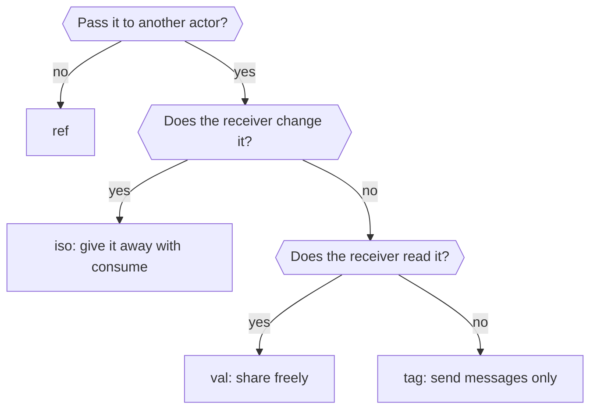

# Capabilities

Every reference has a capability. It says what you may do through it, and what others may do to the same object. The compiler checks it, so data races cannot happen.

```crystal
class Counter
  @n : UInt32 = 0

  def ref incr
    @n += 1
  end

  def count : UInt32 = @n
end

actor Main
  def self.new(env : Env)
    c = Counter.new
    c.incr
    c.incr
    env.out.print("#{c.count}")
  end
end
```

```text
2
```

A method that changes a field is `def ref`. Without it `incr` fails with `cannot write to a field in a box function. If you are trying to change state in a function use fun ref`.

## The six

| Capability | Read | Write | Others may | Send to an actor |
|---|---|---|---|---|
| `iso` | yes | yes | nothing: it is the only reference | yes |
| `trn` | yes | yes | read it (`box`) | no |
| `ref` | yes | yes | read and write it | no |
| `val` | yes | no | read it, from any actor | yes |
| `box` | yes | no | read or write it, as `ref` or `val` | no |
| `tag` | no | no | anything | yes |

A `tag` reference only identifies the object. It is how you hold an actor: you can send it messages, not look inside.

Write the capability before the type: `val String`, `iso Array(String)`, `box Counter`. `def ref incr` puts one on `self`.



## Defaults

Leave the capability off and Sparkle uses the default:

| Where | Default |
|---|---|
| `class`, `struct` | `ref` |
| `actor` | `tag` |
| `primitive` | `val` |
| `def` | `box` |
| `def self.new` | `ref` |
| `be` | `tag` |

A type declaration may set its own default, `class val Point`, so that every `Point` is a `val Point`. A constructor of such a class says so too, `def val self.new`.

```crystal
class val Point
  @x : UInt32

  def val self.new(x : UInt32)
    @x = x
  end

  def x : UInt32 = @x
end

actor Printer
  be show(p : Point, out : OutStream)
    out.print("x = #{p.x}")
  end
end

actor Main
  def self.new(env : Env)
    p = Point.new(4)
    Printer.new.show(p, env.out)
    Printer.new.show(p, env.out)
  end
end
```

A `val` object can be sent to any number of actors. Sending a `ref` one is an error:

```text
argument not assignable to parameter
    argument type is ref Point
    parameter type requires val^ Point
```

## `iso`: one owner

An `iso` value has a single reference. `consume x` moves it: `x` cannot be used afterwards, and the result may be passed on or stored in a new variable.

```crystal
actor Worker
  be process(names : iso Array(String), out : OutStream)
    sealed : val Array(String) = consume names
    out.print("got #{sealed.size} names")
  end
end

actor Main
  def self.new(env : Env)
    names = recover iso do Array(String).new end
    names << "ada"
    names << "grace"
    Worker.new.process(consume names, env.out)
  end
end
```

```text
got 2 names
```

- Consuming an `iso` into a `val` freezes it. Nobody can write to it again, so it can be shared.
- A parameter of an actor behaviour must be `iso`, `val` or `tag`.

## `recover`

`recover iso do … end` builds an object in isolation and gives it the capability. Inside, a `ref` or `box` variable from outside is seen as `tag`: the block cannot read or change it.

```crystal
shared = recover val do
  list = Array(String).new
  list << "x"
  list
end
env.out.print("#{shared.size}")
```

```text
1
```

## Generic constraints

`class Stack(A : val)` accepts only `val` types for `A`. A capability alone constrains to any type with it: `A : val`, or `A : send` for anything sendable. `A : val Stringable` adds a type bound.

| Set | Contains |
|---|---|
| `send` | `iso`, `val`, `tag` |
| `share` | `val`, `tag` |
| `read` | `ref`, `val`, `box` |
| `alias` | `ref`, `val`, `box`, `tag` |
| `any` | all six |

## Reading the errors

| Message says | Usually means |
|---|---|
| `ref Foo is not a subtype of val^ Foo` | A `ref` object is going where a `val` is needed. Build it in `recover val`, or give the class `val`. |
| `cannot write to a field in a box function` | Add `ref` to the `def`. |
| `iso is not a subcap of val^` | Consume it: `consume x`. |
| `can't recover to this capability`, `expression type is tag …` | The `recover` block returns something from outside it. Build the value inside. |
