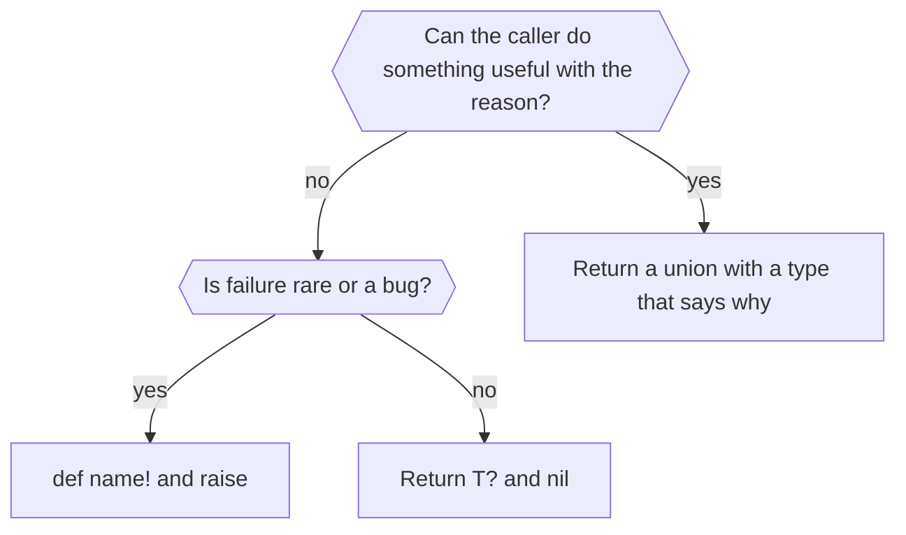

# Errors

There are no exceptions with values. An error has no message and no type: a partial method either returns or fails, and `rescue` handles the failure. The compiler makes you handle every one.

```crystal
primitive Parse
  def digit!(c : String) : UInt32
    if c == "7"
      7
    else
      raise
    end
  end
end

actor Main
  def self.new(env : Env)
    begin
      env.out <~ print("got #{Parse.digit!("7")}")
      env.out <~ print("got #{Parse.digit!("x")}")
      env.out <~ print("not reached")
    rescue
      env.out <~ print("rescued")
    end
  end
end
```

```text
got 7
rescued
```

## Partial methods

A method that can fail ends in `!`, and so does every call to it: `digit!(c)`, `stack.pop!`.

| You write | Meaning |
|---|---|
| `def digit!(c : String) : UInt32` | may fail; callers must handle it |
| `raise` | fail here |
| `x.digit!(c)` | a call that may fail |
| `a[i]!` | an index that may fail, such as `Array` past its end |
| `a[i]! = v` | a write that may fail |
| `x.as!(T)` | a cast that fails when `x` is not a `T` |

`raise` takes no value. A method that calls a partial one is itself partial, unless it handles the failure with `rescue`.

```crystal
primitive Names
  def at_or(names : Array(String), i : USize) : String
    begin
      names[i]!
    rescue
      "none"
    end
  end
end

actor Main
  def self.new(env : Env)
    names = ["ada", "grace"]
    env.out <~ print(Names.at_or(names, 1))
    env.out <~ print(Names.at_or(names, 7))
  end
end
```

```text
grace
none
```

`begin … rescue … end` is an expression: its value is the body's, or the `rescue` branch's if the body failed.

## `ensure`

```crystal
begin
  env.out <~ print("body")
ensure
  env.out <~ print("ensure")
end
```

```text
body
ensure
```

`ensure` runs after the body whether or not it failed, and after `rescue`. All three parts may be present, in the order `begin`, `rescue`, `ensure`.

## Where the compiler insists

An actor's constructor and a message handler cannot be partial. A failing call in one needs a `begin … rescue`. A plain method that calls a partial one without handling it fails with:

```text
function signature is not marked as partial but the function body can raise an error
    an error can be raised here
```

An actor constructor in the same position says `an actor constructor must handle any potential error`. The fix is to add `!` to the method's name, or to wrap the call in `begin … rescue`.

## Choosing



Use `T?` where a missing value is ordinary, and `!` where it is a failure. See [types](types.md).
